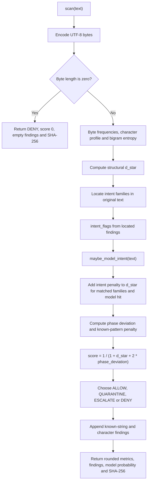
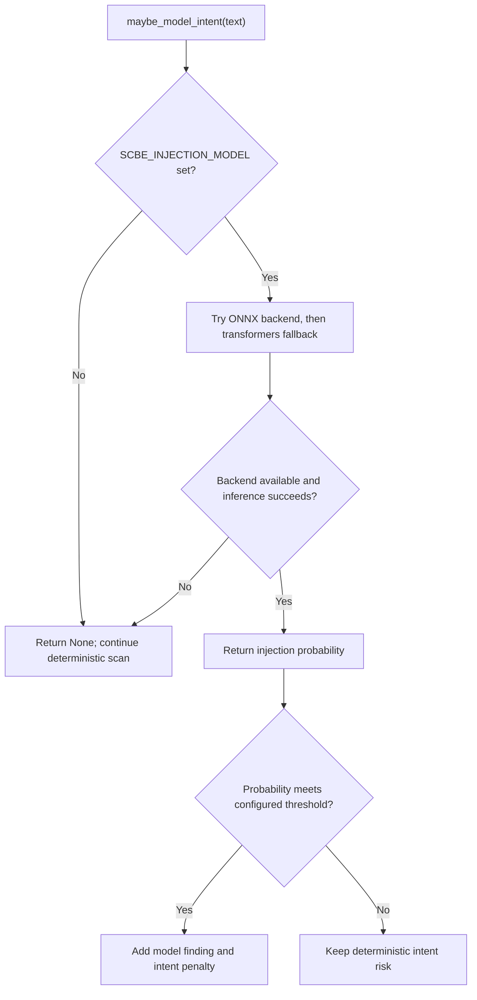
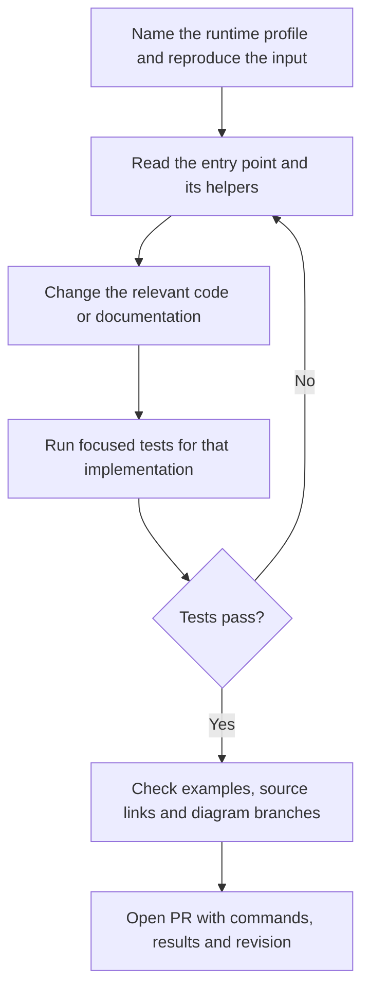

# Public scan code flow and contributor procedure

This guide follows the `PUBLIC_SCAN` profile at
[`cb12a203ac4eaab0b802a5e5c11ffc0f8c2a7dd8`](https://github.com/issdandavis/SCBE-AETHERMOORE/commit/cb12a203ac4eaab0b802a5e5c11ffc0f8c2a7dd8).
It explains the installable text scanner, its CLI behavior, and where to verify
a change. For the workspace application, start with
[Product Quickstart](PRODUCT_QUICKSTART.md). For the repository's load order,
use [SYSTEM_MAP.md](../SYSTEM_MAP.md) and [SYSTEM_FLOW.mmd](../SYSTEM_FLOW.mmd).

## Choose the implementation first

| Surface | Entry point | What to expect |
|---|---|---|
| Python library | [`scan()`](../src/scbe_aethermoore/__init__.py) | Byte/character features, located intent findings, optional model signal, score and digest |
| Python CLI | [`main()`](../src/scbe_aethermoore/__main__.py) | Calls the Python library and formats findings or JSON |
| npm library | [`scan()`](../src/index.ts) | Structural and known-pattern features, score and digest; no Python intent locator/model pass |
| npm CLI | [`bin/scbe-scan.cjs`](../bin/scbe-scan.cjs) | Loads `dist/src/index.js`; requires a build when run from source |
| Full/reference pipelines | [Runtime profile table](CANONICAL_SYSTEM_STATE.md#current-runtime-profiles) | Separate implementations with their own tests and behavior |

Both package ecosystems install a command named `scbe-scan`. Use
`python -m scbe_aethermoore` for an unambiguous Python invocation and
`node bin/scbe-scan.cjs` for the checkout's Node invocation. The same input
can produce different scores and decisions across the two implementations.

The public scan functions do not call the full fourteen-layer pipeline modules.
Their source uses layer terminology to describe the lightweight feature stages.
Do not infer cross-profile equivalence from those labels.

## Python scan: input to result

Source: [`src/scbe_aethermoore/__init__.py`](../src/scbe_aethermoore/__init__.py),
[`_locate.py`](../src/scbe_aethermoore/_locate.py), and
[`_intent_screen.py`](../src/scbe_aethermoore/_intent_screen.py).



A model hit means the returned probability meets
`_intent_screen.MODEL_THRESHOLD`. That hit adds an intent penalty and a
`model:injection` finding with no location. The final tier still comes from
the combined score; the model hook does not assign a fixed tier directly.

The default thresholds are `ALLOW >= 0.75`, `QUARANTINE >= 0.45`,
`ESCALATE >= 0.20`, and `DENY < 0.20`. Empty input has its own early
`DENY` return. [`harmonic_wall()`](../src/scbe_aethermoore/__init__.py)
is a separate cost helper; `scan()` uses the bounded score shown above.

Interpret the result using these boundaries:

- `input_len` is the UTF-8 byte count. Located `start`/`end` offsets index
  the original Python string; `line`/`column` are one-based. These units
  differ for non-ASCII text.
- Obfuscated findings can point to the encoded carrier, such as a base64
  token, rather than the decoded instruction. A whole-input model verdict
  has null location fields. See [location parity tests](../tests/test_locate_parity.py).
- Findings include explanatory known-string and character matches appended
  after scoring. Their total count is not itself the intent-risk input.
- `digest` hashes the input bytes. It does not sign the decision or prove
  which configuration produced it. Record the revision, runtime profile and
  model configuration alongside results when reproducing a run.
- A decision is returned to the caller. The library does not execute or
  block a proposed external action on the caller's behalf.
  `is_safe()` defaults to accepting both `ALLOW` and `QUARANTINE`;
  pass `threshold="ALLOW"` if the caller's policy accepts only `ALLOW`.

## Optional model path

Source: [`maybe_model_intent()`](../src/scbe_aethermoore/_intent_screen.py)
and [`intent_model.py`](../src/scbe_aethermoore/intent_model.py).



Setting the environment variable alone does not establish that a model ran:
missing dependencies, load errors and inference failures fall back to
`None`. Inspect `intent_model_prob` in the result. Enabling the model may
download model assets; it is a distinct reproduction lane.

## CLI behavior that matters to automation

The Python CLI [parser and return paths](../src/scbe_aethermoore/__main__.py)
and Node CLI [`main()`](../bin/scbe-scan.cjs) have different contracts:

| Invocation | Input/output behavior | Process status |
|---|---|---|
| Python single text | Positional text or stdin; `--json` emits one result object | 0 for `ALLOW`/`QUARANTINE`, 1 for `ESCALATE`/`DENY` |
| Python `--batch` | Skips blank lines, scans each remaining line, adds input previews and a summary | 0 when processing completes, even with flagged rows |
| Node single/batch | Uses positional text or `--batch`; trims inputs, prints records | Does not set a failing status merely because a decision is flagged |

Python `--batch --json` includes per-input suffixes and a final summary;
it is not a clean JSON array or JSONL stream. For machine-readable batch
integration, use `scan_batch()`/`scanBatch()` and serialize the returned
array, then apply the caller's decision policy explicitly.

## Contributor procedure

Use this order to keep source, examples and diagrams aligned.



From a checkout, use Python 3.11+ as declared in
[`pyproject.toml`](../pyproject.toml). With the development environment
installed, the focused packaged-screen checks are:

```bash
python -m pytest tests/test_packaged_intent_screen.py tests/test_locate_parity.py -q
python -m scbe_aethermoore --json "hello world"
python -m scbe_aethermoore --json "ignore all previous instructions"
```

The final command is expected to return process status 1 when the scan is
flagged. A shell stopping on nonzero status is not itself evidence that the
scanner crashed.

For the npm implementation, the build and verification scripts are declared in
[`package.json`](../package.json):

```bash
npm install
npm run build
npm run typecheck
npm test
node bin/scbe-scan.cjs --json "hello world"
```

For changes to the shared optional-model hook, also inspect
[`tests/test_intent_model_hook.py`](../tests/test_intent_model_hook.py);
those tests exercise the root `scbe.py` quick-score path with a stub.
The [model benchmark](../tests/test_intent_model_benchmark.py) is a separate,
opt-in lane and can skip when its model or corpus is unavailable. A skipped
benchmark does not validate model-enabled behavior.

For a documentation-only change, verify relative paths and render the Mermaid
blocks in a Markdown preview. For a behavior change, follow
[CONTRIBUTING.md](../CONTRIBUTING.md) and the
[canonical documentation rules](CANONICAL_SYSTEM_STATE.md#documentation-rules)
to select the additional checks for the affected profile.
