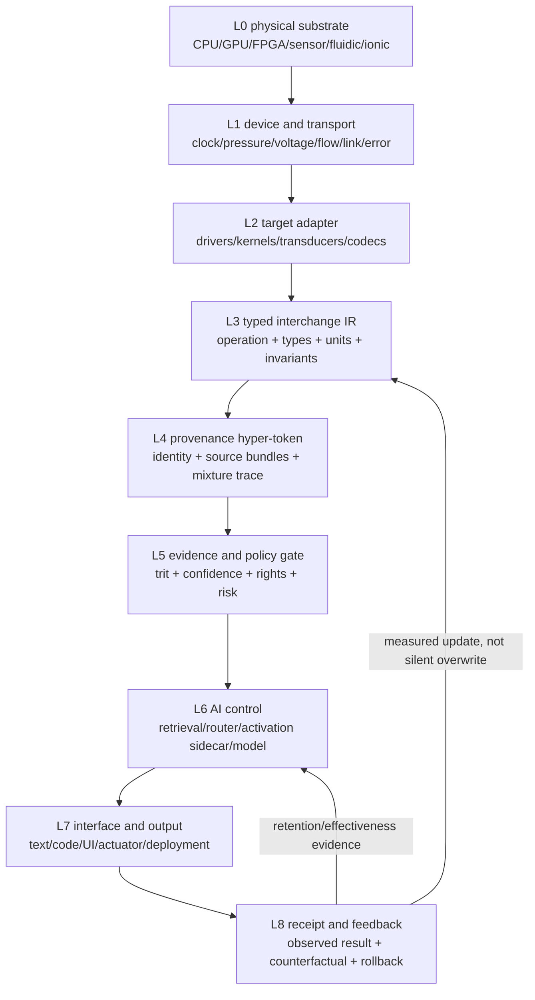

# Hardware–Software–AI Interchange and Discernment Routing

Status: RESEARCH BRIEF; DESIGN HYPOTHESIS; NOT A CAPABILITY OR HARDWARE CLAIM
Date: 2026-11-07
Runtime scope: SCBE repository-wide design; no claim of parity among runtime profiles

## Abstract

The source PDF is a Gemini conversation export containing useful design seeds,
AI-generated synthesis, speculative statements, and unverified citations. It is
not academic authority and is quarantined from training. This brief checks its
main ideas against primary papers, standards, and existing SCBE code.

The technically defensible core is: computation is a physical state transition;
different substrates can implement equivalent operations when they share an
explicit semantic contract; routing must separate hard constraints from learned
preferences; and evidence provenance must survive aggregation. Fluid pressure,
bubbles, ions, electrons, software operations, and model activations are not
interchangeable by analogy alone. They become interchangeable only through
measured transducers, typed intermediate representations, calibration, and
verification at each boundary.

## Raw Idea and Research Question

Raw idea: treat embeddings and evidence as visibly mixed fluids. Preserve their
"swirl"—source identity, order, contribution, and residual pressure—rather than
collapsing everything into one vector. Route a token as a car at a highway
junction: continue, exit to a specialist, cross to another substrate, or return
to the main stream. Treat a non-promoted run as a weak atmospheric side layer,
not discarded weights.

Research question:

> Can a typed, provenance-preserving control plane route equivalent operations
> across software, AI, and physical backends while improving a declared outcome
> over direct routing and matched controls, without corrupting retained model
> behavior or confusing derived views with independent evidence?

## What the Literature Supports

1. **Computation has a physical cost.** Landauer's work connects information
   processing to physical law and reversible computation. This supports a
   hardware layer zero, but it does not prove that every physical process is a
   useful computer.
2. **Interconnect is a first-class bottleneck.** NIST's semiconductor history
   describes rising resistance-capacitance delay as wires shrink and total wire
   length grows. GAA, CFET, backside power, and 3-D integration address device,
   power, and routing constraints; they do not remove them.
3. **Fluidic operations are real but substrate-specific.** Published systems
   demonstrate bubble/droplet gates, latches, clocks, active-flow logic,
   nanofluidic memory, and transistor-like fluid control. They are generally
   slower and application-specific, but can directly control chemistry and
   biological samples without repeated fluid/electrical conversion.
4. **One semantic operation can lower through multiple representations.** MLIR
   uses progressive lowering from high-level dataflow to target-specific code.
   StableHLO and ONNX define portable model operations. Their lesson is to keep
   operation semantics stable while target details become more concrete.
5. **AI routing and steering are conditional, not deterministic guarantees.**
   Mixture-of-experts routes tokens to selected parameter subsets. Activation
   steering can shift behavior, but source choice, intervention layer, dose,
   faithfulness, and side effects matter. Localization does not automatically
   identify the best place to edit.
6. **Discernment is an evidence relation, not a property of sentence shape.**
   Claim-verification systems retrieve and aggregate evidence into supported,
   refuted, or insufficient-information states. Human confirmation bias can
   alter how evidence strength is represented. A system therefore needs explicit
   provenance, contradiction tests, abstention, and calibration.
7. **Provenance has an interoperability standard.** W3C PROV represents
   entities, activities, agents, derivation, and responsibility. RDF named graphs
   provide a useful model for keeping source bundles separate after linking.

## Claim Boundary for the PDF's Main Ideas

| Idea | Classification | Boundary |
| --- | --- | --- |
| Software abstractions correspond to physical transitions | Supported principle | A mapping must name the substrate, encoding, transducer, timing, error model, and energy boundary. |
| Wiring can dominate modern scaling | Supported | The relative bottleneck is workload and node dependent; transistor, memory, thermal, packaging, and software limits also matter. |
| Bubbles or fluids can compute | Demonstrated in bounded systems | This does not imply a general-purpose fluid computer competitive with CMOS. |
| Pressure can act like voltage | Useful circuit analogy with demonstrations | Analogy is valid only where measured transfer functions and operating regimes correspond. |
| Cavitation or sonoluminescence is a useful compute primitive | Speculative | A reliable gate, state encoding, cascade rule, endurance result, and energy comparison are missing. |
| Electric-eel organization inspires stacked ionic devices | Demonstrated bio-inspired mechanism | It supports ionic power/sensing research, not an AI architecture by itself. |
| Activation vectors can dictate model output | Partly supported | Steering changes probabilities; it does not guarantee exact output and needs causal/retention controls. |
| Facts and opinions are internally identical | Metaphor, not established fact | Both can enter as propositions, but source, stance, evidence, confidence, and truth conditions are distinguishable and testable. |
| A trit can encode discernment | Valid interface design | Verdict alone is lossy; confidence, evidence IDs, claim type, time, and provenance must remain separate. |

## Proposed Layered Architecture



Layer zero supplies state transitions. Layer three is the exchange: no backend
is eligible merely because it resembles another. A backend declares exact
operations, input/output types, units, determinism, latency, energy, error,
privacy, availability, and adapters. The router first rejects hard-constraint
violations, then scores eligible paths. Learned scores may order eligible paths
but may not waive hard constraints.

## Hypertext Token Envelope

A hypertext token is not a larger embedding. It is a canonical token occurrence
plus typed edges:

```text
identity:
  occurrence_id, exact bytes/span, tokenizer + mapping hashes
content:
  lexical token IDs and optional embedding references
context:
  section, 5W view, grammar constraints, source kind
links:
  semantic neighbors, evidence claims, operations, hardware representations
provenance:
  W3C-PROV-like entity/activity/agent links and immutable source bundles
discernment:
  verdict trit {-1, 0, +1}, confidence, claim type, timestamp, evidence IDs
policy:
  rights, privacy, permitted outputs, risk and review state
mixture_trace:
  ordered source contributions, relation, weight, transform and receipt
```

Exact identity, provenance, policy, and evidence stay as side channels. They are
not concatenated into an embedding and miscounted as independent observations.

## The Glass, Liquids, Swirl, and Chemical Tests

The metaphor becomes testable when each part has an operational meaning:

| Metaphor | Measurable representation |
| --- | --- |
| Glass | Stable claim or token identity |
| Clear liquid | One source bundle or evidence stream |
| Color/reagent | Independent evidence probe or detector |
| Swirl | Ordered lineage of contributions and transforms |
| Layer height | Contribution mass, not truth |
| Pressure | Routing demand, uncertainty, or constraint residual |
| Sediment/separation | Persistent contradiction or source-specific cluster |
| Trit | Current evidence verdict: support, unresolved, contradict |

Do not average the liquids into one undocumented vector. Keep the component
bundles addressable and compute a display mixture separately. A mixed support
and contradiction bundle should remain `UNRESOLVED`, with both trails visible,
instead of forcing a confident binary result.

## SCBE Reuse Map

| Required part | Existing node | Gap |
| --- | --- | --- |
| Exact token identity | Six Tongues byte bijection; frozen tokenizer views | Need one envelope contract across runtimes. |
| Six-view retrieval | Prime Token Catalog | Capability gain remains unproven; retain lexical authority. |
| Trit representation | Atomic tokenization and governance trits | Need evidence-verdict semantics separate from geometry/security trits. |
| Topological display | `src/aetherbrowser/topology_engine.py` | Current domain allowlists are not evidence quality and must not become truth labels. |
| Task/model routing | OctoArmor and TriLane routers | Current keyword/default routing lacks typed hardware operation contracts. |
| Governance/receipts | GeoSeal, agent bus, evidence packets | Need W3C-PROV-compatible interchange IDs and cross-layer receipts. |
| Activation side layer | Clay frozen-core adapter/E81 work | Structural movement did not establish output behavior; needs closed-loop causal tests. |

The existing E81B structural smoke is directly relevant: a small intervention
moved many activation rows toward the target geometry but restored no exact
behavior. That is evidence against treating geometric proximity as sufficient.
The controller must observe output margin and retention, update a bounded dose,
and stop or roll back when the desired behavior does not move.

## Stratified Residual Field: the Sahara Interpretation

The proposed side layer should behave like accumulating sand rather than a dense
weight replacement. One run deposits a thin, signed, provenance-tagged layer at
the token-stream coordinates it actually observed. Bounded propagation may move
some of that layer along declared grammar, source, tongue, prime, semantic, or
compiler-equivalence edges. It may not spread through an untyped similarity
graph or manufacture evidence mass.

Use separate positive and negative channels so contradiction does not erase its
history. A display can show their signed net, while the stored "swirl" retains
each source contribution. Underpowered or failed runs remain inactive vapor or
sediment. Repeated source-disjoint support may compact into a sidecar checkpoint;
even then, the core and older layers stay frozen and addressable. Demotion removes
route permission instead of deleting bytes.

This turns gradients into an optional implementation detail. The first controller
should be non-gradient and closed-loop: update only a bounded sidecar gain from
measured correct-token margin error. If a learned gate is later justified,
gradients are restricted to a new zero/identity-initialized sidecar and evaluated
against an equal-budget ordinary control.

The architecture and goal should shape a route field rather than force a token.
Legal typed transitions form the road system; the goal supplies a potential and
output boundary; seeds release route mass. A bounded Pareto frontier preserves
routes that trade goal fit, evidence, novelty, cost, and retention differently.
Canonical state hashes merge duplicate computation without merging provenance.
Reversible transforms act like mirrors, while lossy transforms must declare what
cannot be reflected back.

Long mirror-hall runs can be summarized by sparse transition-operator powers or
convergence only when the field is stationary. Such compounding is not evidence
of trillions of independent trials. History-dependent routing must count actual
executed turns, retain bounded witness paths, detect cycles, and compare against
short-horizon explicit rollout.

## Routing Logic

The minimum real router is a deterministic reference implementation:

1. Parse an operation contract with typed inputs/outputs and hard constraints.
2. Enumerate direct and adapter-mediated paths.
3. Reject paths with unit, type, policy, provenance, availability, or budget
   violations.
4. Normalize latency, energy, fidelity, trust, and conversion cost only among
   eligible paths.
5. Select deterministically with an explicit tie-break.
6. Execute through a backend adapter that returns measured outputs and a receipt.
7. Verify output invariants; compare against direct and route-null controls.
8. Store the full mixture/provenance trace and feed only reviewed summary signals
   to retrieval or model sidecars.

This is analogous to a highway interchange: direct execution stays on the road;
an expert backend is an exit; an adapter is the crossing ramp; and return to the
main pipeline is a verified merge. An underpass is a lower-level lowering path,
not an untyped shortcut.

## Validation Plan

### Discernment tests

- paraphrase invariance;
- source removed or source swapped;
- support plus contradiction;
- subjective preference versus externally verifiable claim;
- time-sensitive fact before and after evidence expiry;
- confident persuasive falsehood;
- missing evidence and inaccessible evidence;
- shuffled provenance labels;
- no-input baseline and matched ordinary three-class classifier;
- calibration, selective accuracy, abstention coverage, and evidence sufficiency.

### Routing tests

- same operation on CPU, GPU, simulator, and one physical-substrate emulator;
- direct route versus one-adapter and two-adapter routes;
- type/unit mismatch must fail closed;
- unavailable target must not silently become a different operation;
- route-null and score-shuffled controls;
- measured latency, energy estimate, fidelity, and conversion overhead;
- deterministic replay from receipt;
- output invariants after every merge.

### Model/activation tests

- multiple seeds;
- output-token margin/rank plus internal geometry;
- no-intervention and size-matched ordinary controls;
- source-disjoint development/test split;
- retention on exact behavior, lexical decoys, and unrelated tasks;
- adaptive closed-loop dose versus fixed open-loop pulse;
- promotion only above two pooled standard deviations and both controls.

## Product Translation

The commercial product is not "fluid AI" or guaranteed output control. The
sellable near-term product is a governed interchange and evidence-routing SDK:

- typed backend capability registry;
- portable operation contracts;
- provenance-preserving hyper-token envelopes;
- deterministic route receipts and replay;
- evidence-discernment tests and abstention;
- optional AI ranking inside hard safety and compatibility constraints.

Hardware substrates can be added as adapters after measured conformance. This
gives npm/PyPI packages a concrete user contract, compatibility suite, examples,
and deployment story instead of a collection of speculative features.

## Risks and Failure Modes

- Analogy leakage: a physical resemblance is mistaken for equivalent semantics.
- View multiplication: correlated token views are counted as independent proof.
- Provenance collapse: source mixtures become impossible to audit.
- Open-loop steering: internal activations move but output does not.
- Router self-confirmation: the same model chooses, evaluates, and approves a path.
- Unit blindness: pressure, voltage, probability, and confidence are combined
  without a transducer model.
- Benchmark leakage: session material appears in both catalog and holdout.
- Security leakage: raw agent transcripts contain credentials or private data.
- Product overclaim: a research adapter is presented as production hardware.

## Publication Status

Research Brief. Primary sources were collected and claim boundaries written.
No physical prototype, cross-substrate benchmark, or independent review has
been completed. The source PDF remains a design-seed artifact, not evidence or
training data.
