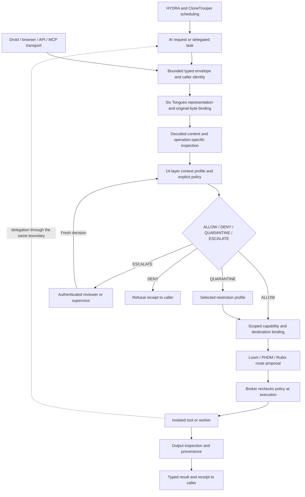

# SCBE agent security and functionality: integration contract

Date: 2026-09-18 (local). Status: local integration demonstrated; deployment gates remain open.

## Product objective

SCBE should wrap different AI models and mediate their tools, computations, scans,
memory, delegated workers and external interfaces. The Six Tongues provide a
shared representation; the 14-layer profile contributes measured context and
risk; GeoSeal and the execution boundary enforce declared permissions. Loom,
Droid, HYDRA and CloneTrooper teams connect through those same interfaces.

The spaceship analogy is useful: compartments have doors, instruments report
conditions, and crew work through controls with limited authority. Every new
interface must identify its actual door, credentials, permitted operations and
return path. A drawing of compartments does not isolate a process.

Universal compatibility means adapters for many tools. Each particular action
still needs permission. The model, its generated code and tool-returned text
must not be able to grant themselves more authority.

## Target flow and current implementation

This is the target architecture, not a claim that every edge is wired today.
The current development harness connects existing nested route proposals,
DCP restricted scopes, Six Tongues round trips, UniversalPort, ActionRegistry,
and real local file/word-count tools plus a GeoSeal command-inspection tool.
It does not execute the entire 14-layer pipeline for each call or provide remote
identity, process isolation, external audit custody or automatic reviewer service.

## Four decisions and multiple quarantine profiles

The inspected DCP and GeoSeal execution-gate enum is **ALLOW, DENY, QUARANTINE,
ESCALATE**. Keep decision separate from tool outcome. A quarantined scan may
successfully complete and report that the command it inspected would be denied.

| Decision   | Required behavior                                                                            |
| ---------- | -------------------------------------------------------------------------------------------- |
| ALLOW      | Run only the authorized operation, resources and budget; return its result                   |
| DENY       | Do not run the requested action; return an explicit reason and receipt                       |
| QUARANTINE | Select an implemented containment profile; permitted work continues and returns results      |
| ESCALATE   | Hold the action pending higher authority; return a review request, not fabricated completion |

`src/governance/runtime_gate.py` separately includes REROUTE. Loom's older
`firewall_react.py` includes TARPIT. Preserve the originating profile and mechanism
instead of silently translating every fourth state to the same meaning.

| Quarantine mechanism           | Located evidence                                                                                                  | What remains                                                                                               |
| ------------------------------ | ----------------------------------------------------------------------------------------------------------------- | ---------------------------------------------------------------------------------------------------------- |
| Inspection/restricted tools    | `src/agentic/quarantine_lock.py` applies `ToolScope.RESTRICTED` to read/scan/verify/explain/status/health classes | Local adapter enforcement demonstrated; OS isolation and executable budgets remain                         |
| Time trap / time-window ban    | Loom `firewall_time.py`, `firewall_react.py`                                                                      | Enforced admission scheduling, bounded defender work, expiry/replay/concurrency checks                     |
| Capability reduction           | Loom firewall removes exec/net/tool flags                                                                         | Every downstream worker must consume the effective capability set                                          |
| Access card / corridor warrant | Obsidian HYDRA import note describes HallPassGuidance, live proofs and nontransferable warrants                   | Candidate conceptual match; exact user-intended access-card implementation is not established              |
| Direct viewing                 | User-defined variant; exact phrase not found in the bounded vault search                                          | Locate source and define whether this means observer-only access, supervision, redaction or something else |

The Obsidian search covered a registered consolidated vault, not every note or
repository. Missing search matches are not evidence that the design does not exist.
The inspected architecture note supports separate continuous state and discrete
decision records; its historic layer names must not overwrite a current code profile.

One operational gap matters: the current `pow_tarpit()` performs the expensive
hash loop in the caller's local process. That is not an attacker-paid challenge
protocol. Its fixed base string is also a development placeholder. A production
time trap needs bounded admission, explicit client work if intended, cheap
verification and a recovery route. More geometric distance alone spends no
attacker compute.

## Existing system connections

| System              | Reuse surface                                                        | Integration responsibility                                                                                                |
| ------------------- | -------------------------------------------------------------------- | ------------------------------------------------------------------------------------------------------------------------- |
| Six Tongues         | `src/crypto/sacred_tongues.py`, `sacred_tongue_payload_bijection.py` | Preserve bytes and representation/version; inspect decoded meaning as well as token structure                             |
| Loom / Rubix        | Loom `clay_rubix_surface.py` and paired-sidewalk experiment          | Face mapping, exact region addresses and proposed paths; no self-issued permission                                        |
| PHDM                | `python/scbe/phdm_router.py`, `phdm_polyhedra.py`                    | Candidate topology/route selection; policy independently checks the proposed transition                                   |
| DCP                 | `src/agentic/dcp.py`, `quarantine_lock.py`                           | Tools, scope, recovery, completion gates and watcher metadata                                                             |
| GeoSeal execution   | `src/crypto/geoseal_execution_gate.py`                               | Inspect command structure; cryptographic capability validation and OS isolation need their own enforcing components       |
| UniversalPort       | `python/scbe/universal_port.py`, `desktop_access.py`                 | Reuse one typed action registry across interfaces; distinguish command strings from ordinary data                         |
| HYDRA               | Loom `clay_hydra.py`, SCBE `src/api/hydra_routes.py`                 | Coordination must preserve task provenance, capability attenuation and revocation; consensus is not authority             |
| CloneTrooper teams  | Loom `octree_clone_squads.py`                                        | Existing count/load scheduler is a simulation; real processes need independent identities, quotas and result verification |
| Droid               | Loom `droid_layer_link.py`, `droid_voice.py`                         | Transport frames and telemetry; audio corruption rejection does not authenticate the sender                               |
| RWP / sealed memory | Existing protocol-specific modules                                   | Preserve exact protocol/version and real crypto backend; check replay, custody and lifecycle before remote use            |

The HYDRA, CloneTrooper and Droid rows are source mappings, not new integration
test results. Training admission stays in the existing reviewed pipeline; tool
receipts do not automatically become trusted memories or training examples.

## Pin the 14-layer profile instead of blending names

The inspected Python reference is
`src/symphonic_cipher/scbe_aethermoore/layers/fourteen_layer_pipeline.py`.
It declares these stages:

| Layer | Stage                     | Boundary requirement                                                            |
| ----- | ------------------------- | ------------------------------------------------------------------------------- |
| 1     | Complex context           | Obtain identity, intent, timing and verification features from declared sources |
| 2     | Realification             | Preserve the specified coordinate convention                                    |
| 3     | Weighted transform        | Version the metric and validate its domain                                      |
| 4     | Poincare embedding        | Check bounds and saturation                                                     |
| 5     | Hyperbolic distance       | Use consistent state and reference versions                                     |
| 6     | Breathing transform       | Preserve valid domain and inverse assumptions                                   |
| 7     | Phase transform           | Track orientation; coordinate changes do not grant authority                    |
| 8     | Multi-well realms         | Bind selected realm to policy and resource scope                                |
| 9     | Spectral coherence        | Specify measured signal, calibration and missing-data behavior                  |
| 10    | Spin coherence            | Record implementation variant and valid feature domains                         |
| 11    | Triadic temporal distance | Bind time/history to trusted records                                            |
| 12    | Bounded safety            | Keep score direction distinct from increasing cost                              |
| 13    | Risk and decision         | Compose with explicit permissions; never soften an earlier hard refusal         |
| 14    | Audio axis                | Record genuine measurement or absence; do not invent sensor evidence            |

These are numeric/context stages, not fourteen independent cryptographic barriers.
Promotion requires measuring how they affect both harmful-action rejection and
legitimate completion against simpler controls. Mathematical proofs cover their
stated assumptions, not an arbitrary deployed adapter or a malware detector.

## Message and enforcement contracts

The production envelope should bind schema, codec and policy versions, request
and parent IDs, principal, action, resource references, destination fingerprint,
argument digest, source trust, expiry and replay/idempotency state. Preserve
original bytes; never replace them silently with a normalized approximation.
Large binary media should use bounded, verified chunks and manifest references.
Each supported transport must retain the same authority checks.

The decision record should separately name the verdict, originating profile,
quarantine mode, allowed operations/resources, expiry, budget, reviewer requirement,
reason and evidence. The executor validates that record for the exact request.
Approval strings supplied by the requesting model are not authorization.

The result record needs execution-started, tool-completed, delivery-completed and
verification status. If output processing fails after a write occurred, report
that fact; do not blindly retry and duplicate the side effect. Tool-returned
instructions remain untrusted data. Re-encode results without granting them
authority over the next action.

Scanner selection must match content type and operation: code/command inspection,
archive limits, destination checks, malware scanning, secret detection and prompt
injection signals have different contracts. Preserve unavailable/inconclusive
states. No score, byte encoding, hash or geometric path proves benign intent.

## Geometry, face tables and the uphill-rain proposal

Geometric hashing also has a more specific computer-vision meaning: indexing
features relative to chosen coordinate frames so transformed objects can be
matched. That is a useful neighboring idea, while face-addressed nested cells
are closer to spatial indexing. [MIT geometric-hashing lecture](https://courses.csail.mit.edu/6.869/lectnotes/lect10/lect10-slides.pdf).

There are close precedents. S2 starts with six cube faces, recursively subdivides
them, and orders cells with linked Hilbert curves. This supports a face plus
nested-cell address. [S2 cell hierarchy](https://s2geometry.io/devguide/s2cell_hierarchy).
H3 supplies hierarchical cells, neighbor operations and directed edges, but its
logical parent hierarchy is not exact geometric containment at every resolution.
[H3 introduction](https://h3geo.org/docs/), [H3 terminology](https://h3geo.org/docs/library/terminology/).

Proposed SCBE address: `(schema, root, child_path, face, orientation, version)`.
Use the existing Rubix face-to-tongue table, rather than guessing from list order.
A cube has six faces; an octagonal prism has eight side faces plus two bases.
Each face can expose typed ports; a cell interior can contain another graph.
Seam transforms translate local coordinates and tangent directions. A height or
cost field changes geometry/weights; topology changes only when connections or
other topological structure change.

Keep locality-preserving addresses separate from cryptographic commitments.
Standard content hashes can bind a canonical cell record; keyed authentication
or signatures can bind a capability. Hashing the address with a cryptographic
hash discards useful neighborhood ordering in the resulting digest. Multiple
views of the same bytes do not create additional independent entropy.

One proposed, unimplemented rule makes the rain analogy precise. For an already
permitted directed edge from cell u to cell v:

`cost(u,v) = base(u,v) + alpha * max(0, U(v)-U(u)) + beta * risk(u,v)`

with finite nonnegative coefficients and costs. Execution requires a valid scoped
capability, a policy-permitted edge, and sufficient authority-managed budget.
Admission atomically debits that budget. Only trusted policy can replenish it.
Denied edges remain denied regardless of available budget. Local field changes
are versioned so a decision cannot be replayed against different terrain.

The effect is an enforceable resource/admission rule, not gravity in the machine.
A scalar potential alone cannot express every directional or cyclic policy;
retain the explicit edge rules. Per-identity and delegated quotas must prevent
parallel workers from multiplying the budget. Bound the defender's work first.
The TLCFI implementation already distinguishes embedding diagnostics from frozen
directed-edge enforcement; preserve that distinction when extending it.

## Release sequence with measurable gates

1. **Local contract slice — demonstrated here.** Real read/count/write tools and
   a command scanner, explicit decisions, restricted inspection, codec checks,
   failure reporting and direct-versus-routed output comparison. Limited to the
   synthetic host-bound workcell. No production security claim.
2. **Enforcing broker.** Bind authenticated identity to exact action/resource;
   reject forged, expired, replayed and wrong-audience capabilities. Quarantine
   profiles need actual allowed operations, exit rules and enforced time budgets.
   Permit useful restricted tasks and measure false refusal rates.
3. **Isolated executors.** Separate process/account/container as appropriate,
   filesystem and network allowlists, no ambient credentials. Test forbidden
   paths, symlinks, redirects, command injection, cancellations and crash recovery.
   Writes need idempotency and independent readback.
4. **One remote surface.** Choose the existing API/MCP release lane and verify
   every ingress and return path, including retries and delegation. Token audience,
   consent, SSRF protection and scope minimization follow the actual transport.
   Do not forward caller credentials indiscriminately. These concerns are covered
   in [MCP security guidance](https://modelcontextprotocol.io/docs/2025-11-25/tutorials/security/security_best_practices).
5. **Teams and media.** Wire one HYDRA/CloneTrooper workload and one Droid/media
   transport through the broker. Test revoked children, partial failure, poisoned
   results, duplicate submissions, exhausted budgets and recovery without bypass.
6. **Package and pilot.** Fresh-install consumer checks, pinned backends, SBOM,
   release provenance, durable independently anchored audit, restore/rotation drills,
   rollback and a limited pilot. Use the existing release-surface manifest.

Known blockers include the placeholder `api/main.py:generate_token`, trusted
RuntimeGate enrollment, authenticated atomic persistence, registry confirmation
semantics and durable audit custody. See [the existing self-assessment](NIST_READINESS.md).
This work does not repair or certify all of those deployment surfaces.

Use [NIST SSDF 1.1](https://csrc.nist.gov/pubs/sp/800/218/final) as a secure development
baseline and the [OWASP Agentic Top 10](https://genai.owasp.org/resource/owasp-top-10-for-agentic-applications-for-2026/)
to organize adversarial cases. Neither a checklist nor algorithm selection is
NIST certification or FIPS module validation.

## How to test the ambition of being best

Report harmful side effects, legitimate task completion, false restrictions,
coverage of adapters and quarantine recovery, p50/p95 latency, memory and cost.
Use the same tools, models, data and hardware for an unwrapped baseline, a simple
capability/sandbox baseline, and the complete SCBE candidate. Fix evaluator
definitions before looking at results. Stochastic claims require multiple seeds,
uncertainty estimates and size/compute-matched controls. Publish failure cases.
No competitive rank or learning gain follows from this local test suite.

## Reproduction and evidence

Local harness: `C:/dev/loom/experiments/agent_security_integration_20260918/`.
Run its focused tests and `python demo.py`; see the harness README for dependencies
on existing source trees. Evidence includes JUnit reports, a demo receipt, and
a source-hash receipt. No cloud service, package release, checkpoint modification
or training run was started by this integration work.
