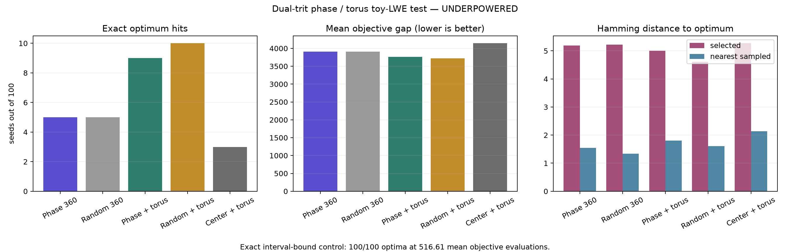

# Dual-trit 360-field and torus footholds — controlled result

Status: **UNDERPOWERED / no measured search advantage on this toy
distribution**. The phase and hyper-torus ideas were implemented with their
existing local components and tested honestly. This result is not an attack on
ML-KEM or ML-DSA.

## Result

The paired benchmark used 100 deterministic tiny LWE instances, dimension 8,
14 equations, modulus 97, and secrets in `{-1,0,+1}^8`. Every heuristic was
limited to exactly 360 complete-candidate objective evaluations. Exhaustive
search checked 6,561 candidates per instance.

| Method | Exact optima / 100 | Mean objective gap | Selected Hamming distance | Nearest sampled distance |
| --- | ---: | ---: | ---: | ---: |
| Dual-trit phase wheel | 5 | 3,911.15 | 5.19 | 1.55 |
| Uniform random | 5 | 3,910.24 | 5.22 | 1.34 |
| Phase seeds + trit torus | 9 | 3,764.14 | 5.00 | 1.80 |
| Random seeds + trit torus | 10 | 3,723.01 | 4.61 | 1.61 |
| Center + trit torus | 3 | 4,142.72 | 5.27 | 2.14 |
| Exact modular interval bounds | 100 | 0 | 0 | 0 |

The exact interval-bound control needed 51,661 / 100 = **516.61** unique
candidate objective evaluations on average, plus its explicitly recorded box
bound work. It agreed with exhaustive ground truth on all 100 seeds.

Machine-readable paired rows and source hashes:
[`toy_lwe_dual_trit_torus_20260907.json`](../research/evidence/toy_lwe_dual_trit_torus_20260907.json).

## What happened to the focal area

The geometry covered the candidate space reasonably well, but the objective
did not tell the search when it had arrived near the answer. The phase wheel's
mean score/Hamming-distance correlation was **-0.00018**. The fallback values
were similarly near zero: **-0.00477** for phase-seeded torus search and
**+0.00992** for random-seeded torus search.

This resolves the apparent contradiction in the anchors:

- the 360 phase probes often included a candidate only one or two trits from
  the exact optimum;
- the candidate with the lowest measured objective was still 5.19 trits away
  on average;
- only 5 of 100 phase runs selected the nearest sampled candidate, exactly the
  number of runs that sampled the optimum itself.

The “other footholds in the region” therefore exist as coordinate neighbors,
but this objective supplies almost no local signal for recognizing them. A
one-coordinate move changes `A*s mod q` across every equation. On these random
toy matrices, nearby secrets do not generally produce nearby residual scores.
The surface behaves more like unrelated modular basins than a physical slope.

## Matched-control decision

The phase wheel tied random sampling at 5 exact hits. Phase plus torus lost
9-to-10 to random plus the same torus search. Its mean objective gap was also
41.13 higher. No paired phase effect exceeded two population standard
deviations. Under the repository's measurement rule, the correct label is
**UNDERPOWERED**, with no useful advantage established.

The phase wheel itself needed 432 generated proposals to obtain 360 unique
candidates because 72 sign-projected phase images collided. Those operations
are recorded; the implementation does not bill 360 labels as one operation.

## What remains useful

The exact dual-trit and torus machinery is valid as a deterministic coordinate,
routing, and receipt system. This test only says geometric proximity is a poor
standalone heuristic for this modular LWE objective. The exact interval method
works because it uses `A`, `b`, `q`, and a proved lower bound for each box.

A future search experiment should derive its ordering signal from those
algebraic constraints—such as residual equation information or established
lattice-reduction features—then use the phase/torus structure to schedule and
audit work. It must still beat random ordering, the exact-bound baseline, and
an established lattice method before any cryptographic claim is made.
