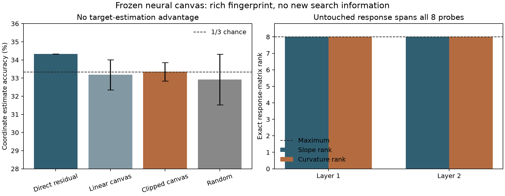

# Frozen neural canvas and dual-trit response calculus

Date: 2026-09-07

Status: **instrument validated; no target-estimation advantage measured**

## The corrected idea

The network does not select telemetry. It is the untouched measurement medium.
A complete mathematical probe bank is declared first, projected through a
newly initialized frozen network, and recorded before an optimizer or learned
readout changes anything.

The hallway/light analogy becomes:

```text
fixed mathematical source
  -> baseline and symmetric probe rays
  -> frozen integer-weight layers
  -> every node response at every depth
  -> exact slope/curvature tensor and signed receipt
```

This is a legitimate system-identification experiment. The blank canvas is not
empty: its architecture, initialization, biases, and nonlinearity already
define how it reflects the probes. Multiple initialization seeds and matched
controls are therefore mandatory.

## Existing work reused

Repository inspection found that this was already described but not
implemented in WaferNet's D4 layer:

- `C:/dev/clay-wafer-net/NEURAL_STRIP_MINE_LAYER_MAP.md` calls for fixed
  activation probes `h_l(x)` at every network depth and labels the neural drill
  unmeasured.
- `C:/dev/loom/case_direction_probe.py` already warns that an untrained matrix
  can return a null control and make a feature test inconclusive.
- `C:/dev/loom/chain_accelerator.py` measures effective rank and caught an
  apparent six-dimensional wafer representation that actually had rank two.
- Existing exact dual-trit, phase, toy-LWE, and oriented-zero modules supply
  the signed states, mathematical inputs, and fail-closed research boundary.

The implementation is
[`frozen_neural_canvas.py`](../../src/crypto/frozen_neural_canvas.py). It uses
deterministically derived weights and biases in `{-1,0,+1}`. They are frozen
tuples, and the module contains no optimizer, backward pass, learned readout,
agent callback, or probe-selection API.

## Exact response calculus

For a base input `x` and every predeclared direction `v`, the canvas records the
positive, baseline, and negative activations at every layer:

```text
h_plus  = h_l(x + v)
h_zero  = h_l(x)
h_minus = h_l(x - v)
```

The node response is retained as exact integers:

```text
first(v)  = h_plus - h_minus
second(v) = h_plus - 2*h_zero + h_minus
```

Each node also receives the existing nine-state dual-trit label:

```text
(sign(first), sign(second)) in {-1,0,+1}^2
```

The first trit records oriented response. The second records local bending.
The integer magnitudes remain beside the labels, so the trits do not discard
strength. Exact rational Gaussian elimination calculates response-matrix rank;
no floating tolerance decides whether a direction is live.

The receipt hashes the canvas identity, complete input bank, every activation,
both differences, every dual-trit state, layer summaries, and the expected
`1 + 2*directions` forward-call count.

## Controlled toy measurement

The benchmark used 300 deterministic toy-LWE instances for each of three
independent canvas seeds. Every instance had dimension 8, 14 public equations,
modulus 97, and a planted secret in `{-1,0,+1}^8`. Each seed therefore produced
2,400 coordinate targets.

The probe bank was fixed before any response: zero plus both signs of all eight
coordinate directions. It was mapped into the 14 exact centered modular
residuals, then projected through two 24-node layers.

Controls:

1. the direct exact residual score;
2. the same frozen ternary matrices with identity activation;
3. the frozen matrices with exact integer clipping at `+/-97`;
4. a paired random trit estimate.

No readout was fitted. Candidate estimates used only the final-layer squared
response energy. All 30,600 frozen-canvas forward calls were charged.

| Method | Mean coordinate accuracy | Population SD across canvas seeds |
| --- | ---: | ---: |
| Direct exact residual | 34.3333% | 0.0000% |
| Same-weight linear canvas | 33.1806% | 0.8336% |
| Clipped nonlinear canvas | 33.3472% | 0.5096% |
| Random trit | 32.9167% | 1.3973% |

The clipped canvas gained 0.4306 percentage points over random, below the
required 2.1034-point two-pooled-SD threshold, and did not win every seed. It
lost 0.9861 points to the direct algebraic score and improved only 0.1667 points
over the same-weight linear canvas, below that comparison's 1.3816-point
threshold. The result is **NO ADVANTAGE** for target estimation.



Machine-readable evidence:
[`frozen_neural_canvas_20260907.json`](../research/evidence/frozen_neural_canvas_20260907.json).
The independent source record is
[`frozen_neural_canvas_sources_20260907.json`](../research/evidence/frozen_neural_canvas_sources_20260907.json).
Validation hashes and commands are in
[`frozen_neural_canvas_validation_20260907.json`](../research/evidence/frozen_neural_canvas_validation_20260907.json).

Validation completed with **322 related tests passing**. The 23 focused canvas
tests cover 98% of the instrument module, Ruff passes all five new Python
surfaces, and a second complete 900-instance run reproduced every field except
elapsed wall time exactly.

## What the light revealed

The canvas was not dead:

- both layers had exact slope rank `8/8` on every instance and initialization;
- both layers had exact curvature rank `8/8` under clipping;
- no node was dead across the complete probe bank;
- all nine dual-trit slope/curvature states occurred;
- the same weights under identity activation had exactly zero central
  curvature, confirming that measured bending came from nonlinear boundaries.

This is the distinction the analogy needed. The frozen canvas produces a rich,
reproducible optical fingerprint of how a particular architecture responds. A
rich fingerprint is not automatically information about the hidden target. On
this task, nonlinear reflections mostly rearranged information already present
in the algebraic residual and slightly degraded the strongest direct signal.

## Productive next use

Keep this exact probe bank as a before/after instrument:

1. Seal the blank canvas seed, architecture, probe bank, and response receipt.
2. Train or fine-tune under a separate contract.
3. Fire the identical probes again.
4. Subtract the original response tensor from the trained response tensor.
5. Test whether the learned deformation predicts held-out behavior better than
   random initialization, a same-size linear map, and shuffled probe labels.

That experiment can identify where training changes rank, sensitivity,
curvature, dead nodes, or phase orientation. It does not need an agent to pick
telemetry. The fixed illumination is the control surface.

For cryptanalytic research, the probe input must continue to come from real
algebraic observables such as modular residuals or reduced-basis state. A blank
network cannot manufacture information omitted from its input.

## Relationship to established work

[Random Features for Large-Scale Kernel
Machines](https://papers.nips.cc/paper/3182-random-features-for-large-scale-kernel-machines.pdf)
formalizes fixed random mappings whose transformed inner products approximate
chosen kernels. [Neural Tangent Kernel](https://papers.nips.cc/paper/2018/file/5a4be1fa34e62bb8a6ec6b91d2462f5a-Paper.pdf)
shows that random initialization already induces a kernel-like structure in
wide networks. Reservoir computing likewise freezes a recurrent substrate and
trains only a readout; the current instrument is earlier than that because it
does not train even the readout.

Those precedents mean “untrained network response” is not itself a new field.
The potentially distinctive contribution is the exact integer probe contract,
dual-trit slope/curvature tensor, complete receipting, wafer-depth comparison,
and a demonstrated trained-minus-blank measurement that beats matched controls.
