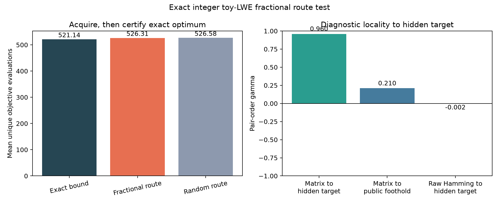

# Matrix geometry, fractional spaces, and the zero pocket

Status: **useful representation; fractional search advantage not measured**.
The matrix-induced geometry is real on the exact toy system, but the tested
public acquisition rule did not turn that geometry into less search work. The
fractional route remains disabled.

## What was reused

The repository was searched before implementation. Two earlier Loom artifacts
already captured the important parts of the idea:

- `C:\dev\loom\signed_zero_division.py` represents direction and order of
  approach to zero, while refusing division by a neutral zero that has no
  approach information.
- `C:\dev\loom\fractional_degree_well.py` treats a zero singularity through a
  bounded limiting field and separates the strength of the pole from its
  numerical cutoff.

The new search code follows the first boundary. It does not turn `a/0` into an
ordinary finite number.

## The exact zero rule

For an ordinary reciprocal,

```text
x -> 0+  gives  1/x -> +infinity
x -> 0-  gives  1/x -> -infinity
```

The two sides cannot be merged at zero. If an uncertainty interval crosses
zero, the honest object is a split state containing the possible negative ray,
neutral unresolved point, and positive ray. Direction and order of approach
can make a limiting quotient meaningful. With neither, neutral zero remains
undefined.

The existing signed-zero implementation was rerun against exact symbolic
limits for 1,000 random function germs. It obtained 1,000/1,000 correct limit
classes, signs, and orders; all 330 equal-order `0/0` cases agreed with repeated
L'Hopital differentiation. Division by its directionless `|0|` was still
refused.

For the search experiment, a zero denominator receives one of two tags:

- `resolved`: the box contains one candidate and has no remaining span;
- `kernel-pocket`: the box contains multiple candidates but the matrix cannot
  distinguish motion inside that box.

The second tag is a useful uncertainty state. Its candidate count could support
a probability model later, but it is not Shannon entropy by itself. A synthetic
zero-column matrix produced the expected kernel pocket. None occurred in the
300 ordinary random matrices.

## Matrix-induced geometry

For candidate vectors `x` and `y`, the experiment uses

```text
d_A^2(x,y) = sum_i center_q(A_i (x-y))^2.
```

This is exact integer arithmetic. Its square root is a pseudometric: distinct
candidates can have zero distance when their difference lies in the modular
kernel of `A`. That collision is why the kernel-pocket tag matters.

For an integer box, each matrix row has an unwrapped interval span. Their
squared spans form the exact nonnegative uncertainty value `U_A(box)`. The
tested acquisition priority was

```text
(F(midpoint) - LB(box)) / U_A(box),
```

where `F` is the exact centered modular residual and `LB` is the proven box
lower bound. Finite ratios use `fractions.Fraction`, so comparisons reduce to
integer cross-products. The fraction only orders work. `LB` remains the sole
pruning authority.

The algorithm first descends one route to acquire a foothold, then drains every
retained sibling with exact branch-and-bound certification. One score cache
spans both stages, so acquisition probes are charged and reused.

## Confirmation result

The locked confirmation panel used seeds 20,000 through 20,299, dimension 8,
14 equations, modulus 97, and all 6,561 secrets in `{-1,0,+1}^8`. Twelve seeds
were also checked exhaustively. Every method returned the same exact optimum.

| Method | Mean unique objective evaluations | Exact acquisition hits |
| --- | ---: | ---: |
| Existing exact interval bound | 521.14 | n/a |
| Lower-bound acquisition, then certification | 524.22 | 3/300 |
| Midpoint acquisition, then certification | 526.67 | 0/300 |
| Fractional-space acquisition, then certification | 526.31 | 0/300 |
| Random acquisition, then certification | 526.58 | 0/300 |

The fraction used 5.17 more objective evaluations than the existing exact
bound. The bound won 279 seeds, tied 2, and lost 19. A few large opposite
outliers kept the paired mean effect below the required two-population-standard-
deviation threshold, so the formal label is **UNDERPOWERED**, not a universal
refutation. It did not beat either required control and therefore stays off.

The fractional method was about 1.45 times the bound's measured wall time in
this run because matrix spans add work. Method order rotated per seed, but Clay
was training concurrently, so objective-call counts remain the primary result.

Putting zero-denominator boxes first or last produced identical work on all 300
confirmation seeds. This panel contained resolved zeros but no kernel pockets;
the zero policy therefore exposed no search signal.

## Where the focal area actually appears

Pair-order gamma measures whether nearer candidates also tend to have lower
objectives. The diagnostic used 128 fixed random candidates per seed.

| Distance view | Pair-order gamma |
| --- | ---: |
| Matrix distance to the hidden target | 0.9600 |
| Matrix distance to the publicly acquired foothold | 0.2097 |
| Matrix distance to the zero anchor | 0.0172 |
| Raw Hamming distance to the hidden target | -0.0025 |

This answers the anchor question. The matrix geometry has strong locality when
the anchor is already the hidden answer. The public foothold retains a modest
part of that locality, while an arbitrary zero anchor retains almost none. The
fractional acquisition did not place the foothold close enough to exploit the
remaining signal.



Machine-readable evidence:
[`toy_lwe_fractional_route_20260907.json`](../research/evidence/toy_lwe_fractional_route_20260907.json).

## Decision and research value

Keep the tagged zero pocket as a control and uncertainty representation. Do not
integrate this fractional priority into GeoSeal or claim a cryptographic
speedup. The next method would need to improve the public foothold without
spending more candidate evaluations than it later saves.

This is a rigorous component of a possible research program, but it is not yet
a standalone publishable cryptanalytic result. Publication-grade positive work
would need a new public anchoring method, scaling beyond exhaustive toy spaces,
comparisons with established lattice methods, ablations, and independent
reproduction. The current result is valuable because it locates the missing
link precisely: **matrix locality exists; public target acquisition does not yet
capture enough of it**.

No claim about breaking ML-KEM, ML-DSA, Kyber, or Dilithium follows from this
experiment.
