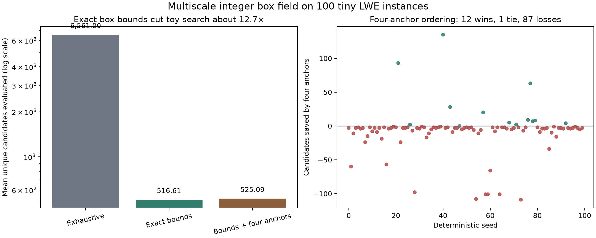

# Multiscale integer box field for LWE — controlled research result

Status: **toy experiment only**. The exact box bound is validated on small
instances. The added four-anchor ordering is **UNDERPOWERED** under the project
measurement rule and showed no advantage. Nothing here breaks, modifies, or
replaces ML-KEM or ML-DSA.

## What the idea becomes mathematically

For a tiny LWE instance

```text
b = A*s + e (mod q)
```

the implementation scores a candidate secret with the exact integer function

```text
F(s) = sum_i center_q(b_i - A_i*s)^2.
```

The candidate cube is recursively bisected. For every box, interval arithmetic
encloses each possible integer dot product in `[L_i, U_i]`. The safe lower bound
is

```text
LB(box) = sum_i distance_mod_q(b_i, [L_i, U_i])^2.
```

If `LB(box)` is greater than the best complete candidate already seen, the
whole box is discarded. This is the rigorous version of searching sectors in a
value field: the field can suggest an order, but only a proved bound may erase
a sector.

“Make the space bigger and smaller at the same time” is represented by two
views of the same residual:

- the full centered modular residual, used for the answer and every pruning
  decision;
- an integer bucket view, used only to rank boxes.

At the root, midpoint, low, high, and two alternating corners form candidate
anchors. Closest and farthest anchors are selected separately under the full
and bucket views. This produces the proposed four-anchor field. There is no
floating-point arithmetic in the search module.

## Measured result

The benchmark used 100 deterministic seeds, dimension 8, 14 equations, odd
modulus 97, and secrets in `{-1, 0, 1}`. Exhaustive search therefore checked
6,561 candidates per instance. Both bounded variants matched exhaustive ground
truth and recovered all 100 planted secrets.

| Search | Mean unique candidates evaluated | Relative to exhaustive |
| --- | ---: | ---: |
| Exhaustive | 6,561.00 | 1.00x |
| Exact interval bounds | 516.61 | 12.70x fewer |
| Bounds plus four-anchor ordering | 525.09 | 12.50x fewer |

The exact bounds are useful on this toy distribution. The four-anchor ordering
won on 12 seeds, tied on 1, and lost on 87. It evaluated 8.48 more candidates
on average than the bound-only control. That paired effect does not exceed two
population standard deviations, so the required label is **UNDERPOWERED**, not
an improvement and not a refutation of every possible multiscale heuristic.



Machine-readable rows:
[`toy_lwe_box_field_20260907.json`](../research/evidence/toy_lwe_box_field_20260907.json).

## The proposed seed “floor”

A 256-bit seed can certainly be written as an integer from `0` through
`2^256-1`. That is an exact notation. It does not give the expanded key material
a useful nearby/faraway metric. FIPS 203 expands `d || k` with SHA3-512 into
`rho` and `sigma` during K-PKE key generation.

A separate probe compared that exact expansion boundary for 4,096 adjacent
integer seed pairs and 4,096 random pairs. The output is 512 bits:

| Input relation | Mean output Hamming distance | Range |
| --- | ---: | ---: |
| Adjacent integers | 1,049,530 / 4,096 = 256.23 bits | 212–296 |
| Random pairs | 1,047,338 / 4,096 = 255.70 bits | 214–298 |

The 0.54-bit mean difference does not exceed two pooled population standard
deviations. This sample found no useful locality: neighboring points on the
integer seed line looked like unrelated points after expansion. It is a boundary
probe, not a proof about SHA3 or an ML-KEM security estimate.

Machine-readable result:
[`mlkem_seed_locality_20260907.json`](../research/evidence/mlkem_seed_locality_20260907.json).

## Corrections to the pasted AI Mode answer

1. ML-KEM and ML-DSA do different jobs and use distinct key-generation
   interfaces. ML-KEM establishes a shared secret; ML-DSA signs and verifies
   data. Using both in one protocol does not create an innate shared key space.
2. An attacker does not generally have to break them simultaneously. Breaking
   a KEM can threaten confidentiality of established keys; forging a signature
   threatens authentication. A protocol may fail badly if either property is
   essential.
3. “Fundamental defeat of quantum computers” is too strong. NIST says the
   schemes are *believed* secure against quantum adversaries and explicitly
   plans reevaluation as analysis and technology change.
4. The error does not create a simple global downhill wake. Primal, dual, BDD,
   hybrid, and distinguishing attacks give formal versions of some of that
   intuition, but they still require a demonstrated advantage against known
   methods.
5. Knowing an LWE error vector does not mean scalar division by `A`. The
   remaining problem is modular linear algebra over vectors or polynomial
   modules, with rank and invertibility conditions.
6. Shared hardware can create timing, cache, power, fault, or entropy failures.
   That is an implementation coupling, not an algebraic requirement linking
   ML-KEM and ML-DSA keys.

NIST defines ML-KEM as a KEM whose security is related to Module-LWE and warns
that conformance alone does not ensure a secure implementation. NIST defines
ML-DSA as a signature scheme based on MLWE and SelfTargetMSIS. FIPS 204 also
explicitly forbids floating-point arithmetic in conforming ML-DSA
implementations because rounding errors can change results. That supports the
exact-integer design requirement, while providing no evidence that decimal
shifting or ternary coordinates increase cryptographic hardness.

## Product boundary for SCBE

The current real GeoSeal path gets one ML-KEM key pair and one ML-DSA key pair
from separate liboqs objects. Its focused tests check real FIPS-sized keys,
round trip, tampering, wrong KEM keys, forged signatures, and distinct keygen
outputs. That is the right separation and those tests passed in this review.

The separate AetherLex `seed` command needs a stronger boundary before it is
used for cryptographic key generation. Its default random phrase has 13 symbols
from a 1,536-symbol alphabet, at most about 137.6 bits if every symbol is chosen
uniformly; a human phrase has less. SHA-512 expands the bytes but cannot add
entropy. The same helper can split one derived value into ML-KEM `d,z` or
ML-DSA `xi`, so users must not reuse a phrase across primitives. For a reversible
random mnemonic, 32 random bytes require at least 25 such symbols and the 64
random bytes used by ML-KEM `d,z` require at least 49. The current floating
weight header is deterministic decoration and contributes no entropy. This
helper should encode random bytes plus checksum and explicit primitive/domain,
rather than treat words as randomness.

The defensible use of this work is a research and telemetry layer:

- keep ML-KEM, ML-DSA, AEAD, key separation, and independent randomness as the
  cryptographic boundary;
- use exact integer geometry to organize candidate search, anomaly telemetry,
  authorization paths, and reproducible receipts;
- require a baseline, randomized controls, multiple seeds, and exact recovery
  before calling any search heuristic useful;
- compare future work with the maintained LWE Estimator and established
  primal, dual, hybrid, BKW, and algebraic attack families;
- never present a low-dimensional toy result as a deployed-key attack.

The next worthwhile experiment is to replace the weak root-only anchor ordering
with a cheaper learned or adaptive branching policy, then compare it against the
same exact bound, random ordering, exhaustive search, and a standard lattice
baseline. The current four-anchor rule should not be integrated into GeoSeal.

The requested dual-trit 360-field and hyper-torus/hypercube follow-up has now
been run. It also showed no measured advantage over matched random controls;
see [`DUAL_TRIT_TORUS_LWE_RESULT.md`](DUAL_TRIT_TORUS_LWE_RESULT.md). The key
diagnostic was near-zero correlation between trit distance and the modular
objective, even when a sampled foothold was physically close to the optimum.

## Primary sources

- [NIST FIPS 203 — ML-KEM](https://doi.org/10.6028/NIST.FIPS.203)
- [NIST FIPS 204 — ML-DSA](https://doi.org/10.6028/NIST.FIPS.204)
- [CRYSTALS-Kyber paper](https://eprint.iacr.org/2017/634.pdf)
- [CRYSTALS-Dilithium specification](https://pq-crystals.org/dilithium/data/dilithium-specification-round3-20210208.pdf)
- [Maintained LWE Estimator](https://github.com/malb/lattice-estimator)
