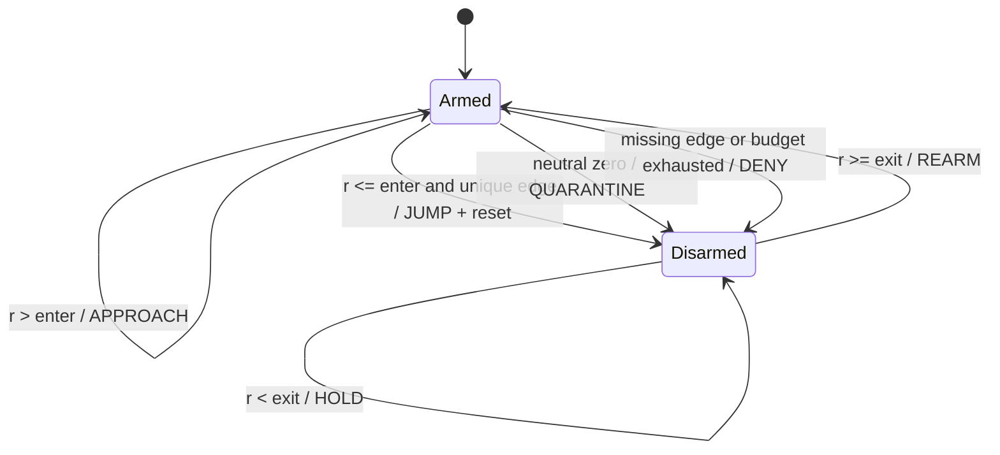
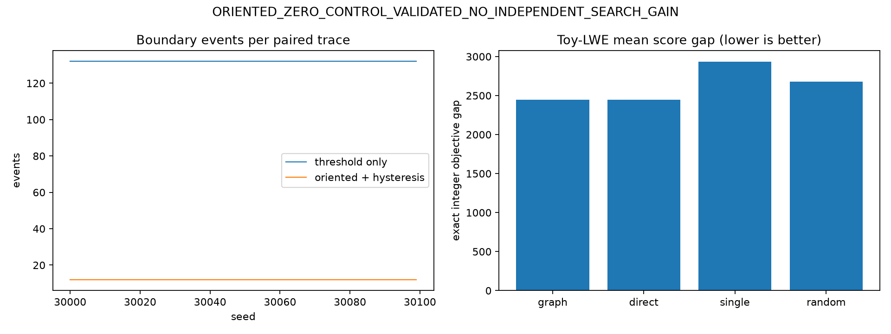

# Oriented-zero ceiling and regional graph transitions

Status: **validated as an exact control and audit primitive; no independent
search gain measured**.

The proposed limit ceiling is mathematically sound when it is treated as a
bounded chart rather than a new value for division by zero:

```text
u(r)       = C h / (r + h)
C - u(r)   = C r / (r + h)
r          = h (C - u) / u
```

Here `r >= 0`, `C > 0`, and `h > 0`. As `r` approaches zero, `u` approaches
`C`; at exact zero the continuous extension is `u(0) = C`. Every operation in
the implementation uses `fractions.Fraction`, so the stored values are integer
numerator/denominator pairs. No floating signed zero, epsilon equality, or
division by zero decides a transition.

## What was reused

The repository and Loom were searched before implementation. The experiment
keeps the useful parts of existing work:

- `C:\dev\loom\signed_zero_division.py` stores side and order of approach while
  refusing directionless neutral zero.
- `src/symphonic_cipher/scbe_aethermoore/ai_brain/fsgs.py` already models
  continuous state plus a discrete governance mode and encodes signed zero as
  explicit bits.
- `src/spiralverse/proximity_optimizer.py` already uses hysteresis to prevent
  rapid mode changes.
- `src/symphonic_cipher/topological_cfi.py` already treats authorized graph
  edges as control-flow authority.

The new isolated research module is
`src/crypto/oriented_zero_hybrid.py`. It does not alter those earlier modules
or connect itself to production GeoSeal decisions.

## Exact state and transition rule

An observation is represented as

```text
x = side * r,  side in {-1, 0, +1},  r >= 0.
```

At nonzero `r`, the side must match `x`. At exact zero, `-1` and `+1` are
remembered approach sides; `0` means the approach information is absent. A
directionless zero is quarantined. The implementation never guesses its side.

The graph jump is a hybrid-system guard:



Each authorized edge is uniquely keyed by `(source region, side, context)`.
What looked like "implied regionality" in the sketch therefore becomes an
explicit deterministic relation. Duplicate edges, undeclared destinations,
and resets inside the destination's exit guard are rejected when the graph is
built.

Four independent bounds stop rapid or infinite cycling:

1. `enter_radius < exit_radius` creates a real dead band.
2. A jump disarms the guard until a later observation reaches the exit radius.
3. A minimum number of discrete steps must separate jumps.
4. Every graph has a finite jump budget.

Input resource bounds are separate from those dynamical bounds: exact integer
components are capped at 4,096 bits, graphs at 1,024 regions and 4,096 edges,
and one trace at 1,000,000 observations. Oversized values fail before graph
iteration or exact arithmetic. An outer service must still apply its own wall-
clock, memory, request-size, and concurrency limits.

The destination reset must land at or beyond its exit radius. This makes the
regional jump a declared chart reset rather than a discontinuity hidden inside
the scalar limit function.

Every observation emits a deterministic SHA-256-linked receipt containing the
source and destination, side, exact radius, chart coordinate and gap, guard
state, outcome, reason, reset, and jump accounting. Replaying the observations
must reproduce every receipt exactly. The hash chain detects changes but does
not authenticate an attacker-controlled history; a production system would
still need an independent signature or trusted ledger anchor.

## Verification result

The focused suite contains 134 tests. It covers exact limits and inverse maps,
large integer numerators, both approach sides, neutral quarantine, missing and
ambiguous routes, malformed states, resets, dwell and budget exhaustion,
receipt tampering, deterministic replay, and randomized long traces. The final
focused run measured 100% statement and branch coverage of the new control
module.

SymPy independently simplified the ceiling-gap and inverse identities to zero,
returned `C` for the right-hand limit at zero, and returned the strictly
negative derivative `-C*h/(h+r)^2`. The prior Loom signed-zero checker also
re-passed 1,000/1,000 limit classes, signs, and orders plus 330/330 equal-order
L'Hopital cases. Its directionless `|0|` remained refused.

The finite-state check exhaustively enumerated all 15,625 length-six traces
over five boundary observations:

| Quantity | Result |
| --- | ---: |
| Enumerated traces | 15,625 |
| Transition steps | 93,750 |
| Invariant failures | 0 |

On 100 paired synthetic chatter traces, each with 12 real approach episodes
and 10 repeated near-zero samples per episode:

| Controller | Mean boundary actions per trace |
| --- | ---: |
| Threshold only, no hysteresis | 132 |
| Oriented guard with hysteresis | 12 |

The hybrid controller emitted exactly one jump per approach episode on every
seed. It won all 100 paired comparisons and exceeded the repository's
two-population-standard-deviation gate. This result measures suppression of
duplicate control events on the deliberately constructed boundary workload;
it is not a cryptanalytic speedup.

## Search-objective control

The same regional graph was used to compile a direct coarse-to-fine coordinate
schedule over 100 exact toy-LWE instances. Each instance had four secret
coordinates in `[-2, 2]`, eight equations, modulus 97, and an exhaustively known
optimum. Candidate scoring and accounting used integers.

| Method | Exact optimum score hits | Mean objective gap |
| --- | ---: | ---: |
| Regional graph schedule | 5/100 | 2449.25 |
| Same schedule written directly | 5/100 | 2449.25 |
| Unit-step local control | 5/100 | 2931.70 |
| Equal-evaluation random control | 3/100 | 2678.26 |

The regional graph and direct schedule matched candidate, score, objective-call
count, and scale route on all 100 seeds. That exact parity is valuable: it
shows the graph can make the transition policy auditable without changing the
underlying algorithm.

The graph schedule beat equal-budget random on 57 seeds, tied 1, and lost 42.
Its mean gap was 229.01 lower, but the effect did not exceed two population
standard deviations. It also failed that threshold against the unit-step
control. The result is therefore **no independent search gain measured**. The
graph records and controls a route; it does not tell the system which region
contains a hidden target.



Machine-readable evidence:
[`oriented_zero_hybrid_20260907.json`](../research/evidence/oriented_zero_hybrid_20260907.json).
The sealed focused run is in
[`oriented_zero_hybrid_pytest.xml`](../research/evidence/oriented_zero_hybrid_pytest.xml)
with
[`oriented_zero_hybrid_coverage.json`](../research/evidence/oriented_zero_hybrid_coverage.json).
The adjacent toy-LWE, FSGS, hybrid-governance, and topological-CFI regression
panel is in
[`oriented_zero_hybrid_regression.xml`](../research/evidence/oriented_zero_hybrid_regression.xml):
277 tests passed.
The five-candidate fail-closed review is recorded in
[`ORIENTED_ZERO_HYBRID_SECURITY_VALIDATION.md`](ORIENTED_ZERO_HYBRID_SECURITY_VALIDATION.md).

## Decision

Keep this construction as a candidate control primitive for chart changes,
checkpoint phases, and post-hit route linearization. It gives a precise answer
to "first hit the target, then linearize the route": the hit condition triggers
a unique edge and the receipt chain reconstructs the ordered region path.

Do not present it as a target finder or wire it into production cryptographic
authorization yet. A later GeoSeal integration should first define who signs
the graph, which external evidence supplies the context and approach side, and
how quarantine is handled outside the model. Search research still needs a
publicly observable anchor that predicts the hidden target strongly enough to
beat both a size-matched control and the no-intervention baseline.

This is solid, testable hybrid-control engineering. It is not by itself a
publishable break of ML-KEM, ML-DSA, Kyber, or Dilithium.
