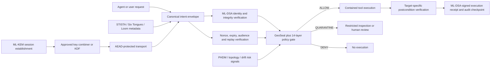

# SCBE compared with post-quantum cryptography families

Date: 2026-09-25

## Engineering conclusion

SCBE should use standardized post-quantum cryptography as its cryptographic
foundation and place its original systems above that foundation:

- **ML-KEM-768** establishes a shared secret for an encrypted channel.
- **ML-DSA-65** authenticates agents, policies, decisions, software and receipts.
- **GeoSeal, the signed-intent protocol and the 14-layer gate** decide whether an
  authenticated action is authorized, contained and successfully completed.
- **STISTA, the Six Tongues, Loom/Rubix and the bijective tokenizer** provide a
  canonical, reversible representation that can be signed and inspected.
- **PHDM, hyperbolic distance, harmonic fields, trits, polarity and decimal
  drift** can provide routing, anomaly and policy signals. They do not add
  cryptographic security bits by themselves.

That is a useful architecture. Post-quantum cryptography answers "who sent this
and can outsiders read or alter it?" SCBE answers "is this authenticated action
allowed here, under this policy, and did it achieve the declared result?"

## Corrections to the pasted AI summary

1. ML-KEM is a key-encapsulation mechanism, not a bulk-data cipher. Its shared
   secret is used with symmetric authenticated encryption such as AES-GCM.
2. The FIPS 205 name is **SLH-DSA**, not `ML-SLHSA`.
3. NIST selected **HQC** as the code-based backup KEM. Classic McEliece was not
   selected for standardization.
4. ML-KEM plus ML-DSA does not double security strength. They perform different
   jobs and both use module-lattice assumptions.
5. Isogeny-based cryptography currently has no NIST standard suitable for this
   product. It belongs in a research adapter, not a production trust path.

## Standards-to-SCBE comparison

| Family or mechanism | Standard/status | Security job | Current SCBE position | Main gap | Recommended SCBE use |
|---|---|---|---|---|---|
| ML-KEM-768 (Kyber-derived) | FIPS 203, final | Establish a shared secret over a public channel | Real native `liboqs` backend is working in `src/crypto/pqc_liboqs.py`; local round trip produced the expected 1,184-byte public key and 1,088-byte ciphertext | Multiple older wrappers can silently simulate a KEM | Make the fail-closed provider the only production KEM path; bind the entire handshake transcript and feed the result into an approved KDF/key-combiner and AEAD protocol |
| ML-DSA-65 (Dilithium-derived) | FIPS 204, final | Authenticate a signer and detect modification | Real signatures work in the canonical Python provider and governance decision envelope; tampered messages were rejected | A legacy SpiralSeal fallback accepts any 32-byte value with a marker when no PQC backend exists | Remove the permissive fallback; use ML-DSA for intent envelopes, policy manifests, execution receipts, model/checkpoint manifests and release artifacts |
| SLH-DSA (SPHINCS+-derived) | FIPS 205, final | Hash-based post-quantum signatures with a different assumption family | A supported algorithm name is discovered, but no complete SCBE signing workflow was found | No independent signature-family backup | Add SLH-DSA for low-frequency root, release and long-lived archive signatures; keep ML-DSA for high-volume agent traffic |
| LMS/XMSS | NIST SP 800-208 | Stateful hash-based signatures | No production integration found | State reuse can destroy security | Use only for a tightly controlled offline signing service with durable state, never as a general agent key |
| HQC | NIST-selected code-based backup KEM; standard still in development | A KEM based on a different problem family from ML-KEM | No production integration found | Not yet a finalized FIPS and larger resource cost | Reserve a provider identifier and interoperability harness now; do not advertise or require it as a finalized production primitive yet |
| FN-DSA/FALCON | Additional NIST signature standard still in progress | Compact lattice-based signatures | No production integration found | More difficult implementation and side-channel profile; final standard pending | Keep an adapter slot and wait for the finalized standard and mature maintained libraries |
| Isogeny-based schemes | Experimental; no NIST production standard | Potential small-key public-key cryptography | Conceptual overlap only | The former SIKE candidate was broken; no approved deployment target | Research only, completely isolated from authorization and key management |
| AES-256-GCM plus SHA-2/SHA-3/SHAKE/HKDF | Established symmetric/hash primitives | Encrypt and authenticate payloads; hash and derive keys | AES-GCM and standard hashes exist in SCBE paths | Custom hashes and geometric scores are sometimes described too close to cryptographic primitives | Keep standard primitives as the security boundary; use SCBE fields as authenticated metadata and domain-separation labels |

Official references: [FIPS 203](https://csrc.nist.gov/pubs/fips/203/final),
[FIPS 204](https://csrc.nist.gov/pubs/fips/204/final),
[FIPS 205](https://csrc.nist.gov/pubs/fips/205/final),
[SP 800-227](https://csrc.nist.gov/pubs/sp/800/227/final), and
[NIST's HQC selection](https://www.nist.gov/news-events/news/2025/03/nist-selects-hqc-fifth-algorithm-post-quantum-encryption).

## How the original SCBE systems fit

| SCBE component | Strong, defensible role | Claim to avoid | Engineering improvement |
|---|---|---|---|
| Six Tongues, STISTA and bijective tokenizer | Canonical encoding, reversible views, domain labels, cross-language normalization and policy-visible semantics | Calling the encoding itself encryption, authentication or additional security bits | Version the mapping; prove round trips and canonical uniqueness; sign the canonical bytes plus the human-readable interpretation |
| GeoSeal execution gate | Authorization, command containment, path restriction, quarantine and verified postconditions | Treating a policy score as proof of identity | Require a verified signed-intent envelope before privileged execution; bind the exact command, target, policy version and postcondition into the receipt |
| Signed-intent protocol | Binds subject, audience, route, action, parameters, nonce, expiry and policy | Letting a tongue sequence or route grant authority by itself | Standardize one envelope schema and algorithm registry; add ML-DSA suites and explicit anti-downgrade rules |
| 14-layer pipeline, PHDM and hyperbolic/topological metrics | Risk scoring, anomaly detection, routing cost, separation and explainable policy evidence | Deriving cryptographic strength from geometry, harmonics or layer count | Bound every metric, define units and invariants, compare it against controls, and place the result inside the signed receipt |
| Trits, negative trits, multi-sign and decimal drift | Rich state representation, confidence/polarity history, drift detection and error-correcting metadata | Using those values as secret entropy or as a replacement for a reviewed hash/KDF | Serialize them canonically, authenticate them as associated data, and test collision, ambiguity and mutation behavior |
| Triadic braid and custom hashes | Transcript organization, redundant checks, indexing and tamper-evident application metadata | Calling a custom transform collision-resistant or quantum-resistant without cryptanalysis | Retain a standard cryptographic digest as the authority; evaluate the custom layer separately as an error-detection/indexing mechanism |
| HYDRA, CloneTrooper teams and fleet logic | Multi-agent policy, M-of-N approval, role separation and failover | Calling policy voting threshold cryptography or Byzantine consensus without the required protocol proof | Verify each member's signature, bind membership/epoch/quorum, test equivocation and partitions, and use a real threshold scheme if threshold keys are required |
| Mars relay and offline/blackout operation | Store-and-forward envelopes, replay control, delayed verification and reconciliation | Assuming an append-only log is confidential or authentic by itself | Use monotonic sequence numbers, nonces, expiries, signed checkpoints, Merkle roots, revocation snapshots and conflict rules |
| Quines and wafers | Reproducible templates, deterministic transforms, routing structures and compact program/data descriptions | Treating self-reproduction as randomness or a cryptographic one-way function | Hash and sign the exact code, inputs, version and output; verify reproducible builds and forbid self-modification outside a governed update path |

## Target architecture

The custom representations are inside the authenticated transcript. They can
change routing and policy, but they cannot silently change who is trusted, which
algorithm was negotiated or which bytes were authorized.

## Confirmed implementation findings

### Working foundation

- The local Python provider selected native `liboqs` and reported
  `ML-KEM-768` plus `ML-DSA-65` as quantum-resistant production algorithms.
- A live ML-KEM round trip matched its shared secret.
- A live ML-DSA signature verified and a modified message failed verification.
- Forty focused tests passed across provider status, real dual-lattice use,
  ML-DSA decision envelopes and the GeoSeal execution gate.
- The experimental tongue lattice encryptor already fails closed unless an
  explicit insecure-development flag is set.

### P0: block production until repaired

1. **Remove permissive legacy signature fallback.**
   `src/symphonic_cipher/scbe_aethermoore/spiral_seal/signatures.py` accepts any
   `FALLBACK_SIG:` value with a 32-byte body when a PQC backend is absent. The
   live `seal.py` verifier calls this module, so this is reachable rather than
   dead documentation. Absence of ML-DSA must produce an explicit error.
2. **Remove simulated legacy KEM fallback.**
   The neighboring `key_exchange.py` silently substitutes a hash construction
   for Kyber/ML-KEM. Route it through the canonical fail-closed provider.
3. **Disable the exported TypeScript `HybridKEM` until it is real.**
   It labels a random seed plus SHA-256 as ECDH, hashes the public value during
   encapsulation but the private value during decapsulation, and combines values
   with an ad hoc XOR. Implement an approved classical scheme such as X25519
   plus ML-KEM-768 and a reviewed SP 800-227-compatible combiner.
4. **Redesign `DualLatticeConsensus`.**
   Remove the unsupported "factor of 2 quantum resistance" claim. Do not hash
   ML-DSA secret-key bytes into a consensus token. Do not truncate an authority
   binding to 64 bits. Sign a public, canonical transcript containing the KEM
   ciphertext, algorithm identifiers, context, policy, nonce and expiry.
5. **Do not treat the runtime reflex cache as authentication.**
   `_has_auth_token` currently recognizes a short BLAKE2s action hash already in
   local reflex memory; its own comment says production signature verification
   is still pending. Restrict this to a post-authentication performance cache
   keyed by subject, action, target, policy version and expiry.

### P1: production hardening

1. Create one provider registry containing algorithm identifier, parameter set,
   backend, library version, approval status and permitted environments.
2. Reject simulation backends, unknown algorithms, algorithm downgrades and
   missing native capabilities in production before accepting traffic.
3. Add complete key lifecycle controls: generation, protected storage, public
   key registration, rotation, overlap, revocation, compromise recovery,
   zeroization and audit-chain continuity.
4. Add SLH-DSA as an independent offline/root signature family for release
   manifests, policy roots and long-lived audit checkpoints.
5. Use transitional dual signatures only where migration requires them. The
   signed envelope must name every required algorithm, and verification must
   reject removal of either signature.
6. Sign the same canonical envelope in Python and TypeScript and require
   cross-language verification against fixed test vectors.

### P2: agility and assurance

1. Reserve an HQC provider slot and test-vector format, but keep it experimental
   until the NIST standard and mature libraries are available.
2. Maintain a cryptographic inventory and software bill of materials listing
   every key, algorithm, backend, call site, protected asset and retirement date.
3. Add known-answer tests, malformed-input tests, fuzzing, replay/rollback and
   downgrade tests, cross-library interoperability and key-rotation drills.
4. Benchmark signing, verification, encapsulation, decapsulation, envelope size
   and fleet throughput on the actual target machines.
5. Commission independent review for side channels, randomness, key handling
   and protocol composition before making a certification or security-strength
   claim.

## Release gates

SCBE is ready to describe as a post-quantum-capable agent security wrapper when
all of these statements are mechanically true:

- No production route can select a simulated or format-only crypto backend.
- Every privileged action is tied to a verified identity and a canonical signed
  intent containing route, action, parameters, audience, policy, nonce and time.
- Every encrypted channel uses a real KEM and authenticated encryption protocol.
- Algorithm negotiation is authenticated and resists downgrade.
- Secret keys never enter logs, hashes, policy scores or serialized receipts.
- Quarantine still reaches only explicitly permitted restricted tools.
- Execution receipts include a target-specific postcondition and are signed.
- Rotation, revocation, replay, partition and compromised-agent tests pass.
- Claims about geometry, harmonics and topology are reported as measured policy
  behavior rather than cryptographic hardness unless separately proven.

This is an engineering comparison and hardening plan, not NIST validation or a
formal proof of security.
