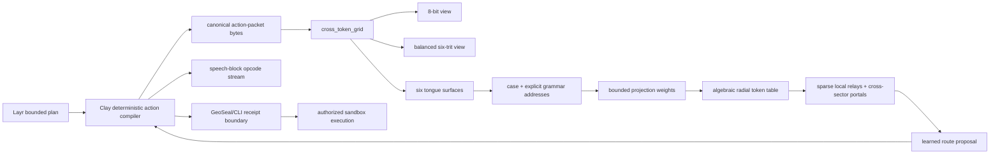

# Cross-token language-family grid: existing system map and staged join

Date: 2026-11-10

Mapped SCBE base: `60d35a022`. Mapped Loom Layr adapter commit: `82a05b2`.

## Decision

Do not build another tokenizer. The required mechanics already exist across
SCBE and Loom. The next useful unit is a receipted training/planning join that
keeps one canonical observation while exposing its deterministic byte, bit,
trit, tongue, case, grammar, action, and radial coordinates.

The join is not execution authority. GeoSeal and the deterministic Clay action
compiler remain the integrity and execution boundaries. Learned geometry may
propose a route; it may not invent or execute an action token.

## Concrete inventory

| Capability | Existing authority | Status |
|---|---|---|
| Canonical byte/action packet | `C:\dev\_wt_clay_layr_action_adapter_20261110\experiments\clay_action_compiler_20261109\layr_action_plan.py` | Exact, CRC-bound, tested |
| Byte/bit/trit/six-tongue aligned grid | `cross_token_grid` in the same module | Exact deterministic projections with validity mask |
| Tongue-independent opcode meaning and executable action binding | `C:\dev\loom\tongues\tongue_semantics.py` | Exact mapping; compiler remains authority |
| Exact surface case possibilities | `python/scbe/token_surface_routes.py` | Algebraic address, no exponential table allocation |
| Six S/V/O family orders | `python/scbe/token_surface_routes.py` and `src/harmonic/linguisticCrossTalk.ts` | Exact parity-tested permutations |
| Seeded radial cells, sector movement, local relays, portals, flash | `python/scbe/algebraic_radial_token_table.py` | Deterministic mechanics, no quality claim |
| Atomic semantic/trit state | `python/scbe/atomic_tokenization.py` | Deterministic feature generator with unresolved-evidence boundary |
| GeoSeal transport/integrity boundary | existing GeoSeal CLI | External authority; not duplicated here |
| Prospective source-disjoint evaluator | E92 v4 chain | Live, waiting; scoring and training remain closed |

## One origin, many correlated projections

For action-frame row `i` and packet position `j`, let the canonical observed
byte be `b[i,j]`. Every deterministic view carries the same origin key:

`origin = (plan_receipt_sha256, frame_index, packet_offset, byte_value)`.

The derived views are:

```text
beta(b)      = exact 8-bit binary expansion
tau(b)       = exact six-trit balanced-ternary expansion
lambda_t(b)  = exact surface in tongue t, t in {KO, AV, RU, CA, UM, DR}
c(s)         = binary case index of the observed surface s
g(role,t)    = slot of observed role in tongue t's S/V/O order
r(s,role,t)  = 6*c(s) + tongue_index(t)
psi(...)     = bounded eight-lane case/role/slot projection
```

`beta`, `tau`, the six `lambda` surfaces, `r`, and `psi` are correlated views
of one observation. They do not multiply the sample count or Shannon capacity.
An experiment row must declare `independent_evidence_count = 1`.

## Algebraic grid and sector relay

The radial table is derived before tokens fill it. For cell `i`, sector `s`,
ordinal `o`, and harmonic pair `p`, the existing implementation uses:

```text
theta_i = golden_angle*(o+1) + 2*pi*s/S + seed_phase
radius_i = sqrt((o+0.5)/cells_per_sector)
x[i,2p:2p+2] = radius_i/(p+1) * (cos((p+1)theta_i), sin((p+1)theta_i))
```

A token carrier is the unit-normalized sum of its stable identity vector and
explicit bounded weights. It occupies the best aligned cell:

`cell(token) = argmax_i <unit(identity(token)+weights(token)), x_i>`.

Sector parameters apply shared orthogonal Givens rotations. This preserves
within-sector norms and distances while allowing cross-sector portals to be
re-ranked. The current relay value is:

`g(i,j,d) = m*exp(-beta*||x_i-x_j||^2)*cos((d+1)*(theta_j-theta_i))`.

Its sign becomes `-1`, `0`, or `+1`; selected outgoing magnitudes are
normalized. `flash` is therefore a sparse sector-by-sector channel, not dense
all-token attention. `ABSENT`, `UNMEASURED`, and measured neutral zero remain
different states.

## Bifurcated training arrays

The proposed row has two branches joined only by the canonical origin key:

```text
canonical action packet
  |-- identity/language branch
  |     byte -> bits -> trits -> six tongue surfaces
  |     exact surface -> case address -> observed S/V/O route
  |     -> radial carrier -> sector cell -> sparse relay proposal
  |
  `-- action branch
        family token + method token + source tongue + bounded payload
        -> exact ActionFrame -> CRC packet -> ActionTape -> speech opcodes
        -> deterministic compiler verdict
```

The language branch may learn which sector/portal should propose an action
route. The action branch supplies the exact target and rejects invalid output.
This gives multilingual alignment without turning geometry into permission.

## Dependency graph



The apparent cycle is deliberate: learned routing returns only a proposal to
the exact compiler. The compiler, GeoSeal, and sandbox do not inherit learned
authority.

## Missing edges

1. No canonical join receipt currently binds a Layr grid origin to an SCBE
   case/grammar route and radial-table receipt.
2. No source-disjoint dataset currently supplies explicit S/V/O roles for the
   action-plan surfaces. A role may not be guessed and recorded as observed.
3. No controlled result shows that radial sectors improve exact action routing,
   multilingual transfer, throughput, or false-route rate.
4. No fused native kernel exists. Current Python mechanics are suitable for
   verification and small experiments, not a speed claim.

## First controlled experiment

Train a small proposal adapter over immutable deterministic rows. Compare the
candidate against all of the following at equal trainable width and update
budget:

- canonical byte/lexical baseline;
- no-intervention baseline;
- equal-width random features;
- shuffled tongue binding;
- shuffled case binding;
- shuffled role-to-slot binding;
- shuffled radial cell/sector binding;
- route-null graph with the same outgoing edge count; and
- case, grammar, trit, tongue, and geometry ablations.

Use at least three predeclared seeds. A claim must beat the size-matched control
and no-intervention baseline by more than `2 * pooled_sd`, pass the paired
finite-sample gate, and retain per-seed results. Report `UNDERPOWERED` rather
than `REFUTED` when the effect-size gate is unresolved.

Primary metrics:

- exact action packet and ActionTape agreement;
- exact speech-opcode agreement;
- cross-language consistency for the same canonical action;
- false-route and abstention rates;
- source-disjoint generalization; and
- end-to-end input-to-compiled-action latency and throughput.

## Partial unfreeze rule

No partial unfreeze is authorized by this map. If a frozen proposal adapter
passes the overall gates and shows reproducible gains isolated to predeclared
sectors, a separate preregistered study may unfreeze only those sector adapters.
It must retain a frozen-core arm, a parameter-matched null arm, and a
no-intervention baseline. Passing one sector cannot authorize unrelated
sectors, the compiler, GeoSeal, or execution policy.

## Claim boundary

This map proves component existence and identifies a bounded integration path.
It does not prove that language families naturally occupy the proposed shape,
that radial routing learns faster, that harmonics add information, or that the
system is ready for training intake, execution, partial unfreezing, serving,
merge, or promotion.
