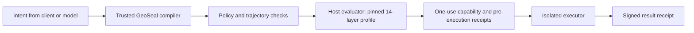

# Connecting a trusted execution host

Plan execution now requires `RunOptions.secureExecution`. An ALLOW plan without
that context is blocked. The old synchronous `execPlan` returns a migration
refusal and never launches a process. `compilePlan` remains available for review.



Use the existing `CapabilityAuthority`, `FileReplayStore`, `FileReceiptJournal`
and `DockerSandboxExecutor` in a trusted process. The authority now requires:

```ts
const authority = new CapabilityAuthority({
  issuer,
  keyId,
  key, // Read from the host's secret store, never an event.
  topologyPolicy: {
    profile: 'TS_PIPELINE14',
    evaluatorSha256, // Pin the evaluator/config bundle deployed by this host.
    representationsProfile: 'byte-trit-stista-multisign-v1',
  },
});

const secureExecution = {
  context, // Existing authority, replay store, journal, executor and identity.
  grant: {
    workspaceAccess: 'read',
    topology: async (compiledPlan) => trustedEvaluator.evaluate(compiledPlan),
  },
};

await runPipeline(intent, { geosealBin: trustedCompiler, secureExecution });
await startAgentBusServer({ authToken, geosealBin: trustedCompiler, secureExecution });
await processOneEvent({ geosealBin: trustedCompiler, secureExecution });
```

This is host integration pseudocode: `trustedEvaluator` must be the actual
configured evaluator. Do not fill its return value with a fabricated ALLOW or
test hashes. The evaluator returns `TopologicalAuthorizationEvidence`: named
profile, ALLOW decision, evaluation/expiry times, full plan digest, evaluator
digest, risk receipt digest, and all four representation digests. The authority
checks identity, completeness, binding and freshness at issue AND verification.
Hash checks identify evidence; they do not independently attest that an evaluator
ran honestly. Its process, feature extraction, configuration and keys remain
part of the trusted computing base.

`TS_PIPELINE14`, `PY_REFERENCE14`, `PY_FULL14`, and `PUBLIC_SCAN` remain distinct
profiles. Changing profiles or evaluator bundles requires an explicit host
policy change. Pinning prevents substitution; it does not make their algorithms
equivalent. Real cross-profile behavior tests are still required before migration.

## HTTP and queued work

- Execution-enabled HTTP servers require an `authToken` of at least 32
  characters. Use a randomly generated secret; length alone is not entropy.
  Send `Authorization: Bearer ...`; all routes except `/health` are protected
  when authentication is configured. `postAgentBusEvent` accepts `authToken`.
- HTTP `/v1/pipeline` and `/v1/pipeline/compile` accept the intent. Client
  `options` are rejected; callers cannot replace the compiler, workspace,
  permission mode, evaluator or key-bearing context.
- Queue receipts omit secure contexts, executable paths and credentials.
  `processOneEvent(options)`, `drainQueue(options)` and
  `startQueueWorker(intervalMs, options)` receive trusted configuration in the
  worker process. Serialized options are not used for execution, including when
  loading receipts created by older versions.
- Registered direct tools are a separate host integration, disabled by default
  in both direct and queued calls. Explicit `allowToolDispatch: true` allows
  trusted registered tools on the host; it is NOT a sandbox capability. Keep it
  off on model-facing deployments and use the secure pipeline instead.

The Docker executor requires a digest-pinned, locally available image. It uses
no network, a non-root user, dropped capabilities, a read-only root filesystem
and resource limits. Control state must be outside a granted writable workspace.
An unavailable Docker daemon fails closed; it never triggers host execution.

No running-container containment test was possible on the reviewed machine:
the Docker CLI exists, but its daemon pipe is absent. Python GeoSeal's explicit
local command runners and Hydra services in other checkouts remain separate
integration/audit targets. The current `src/api/hydra_routes.py` imports absent
spine/head modules and exposes the documented unavailable state.
