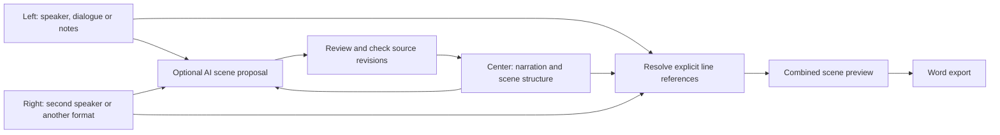

# Spiral Word scene board

The existing FastAPI application owns document editing, AI provider dispatch,
governance and DOCX export. The new `/board` workspace adds sections containing
left, center and right writing lanes. Each lane keeps its own speaker, format,
text and revision. A local SQLite store preserves board edits across restarts;
existing text documents and the Textual UI remain available.

Left/right lanes can contain dialogue, prose, Markdown or notes. The center is
the scene draft. Insert `{{left:1}}` for the first line of the left lane,
`{{right:2}}` for the second line on the right, or `{{left}}`/`{{right}}` for a
whole lane. Preview resolves references in a single pass and records source
revisions/hashes. Plain center prose remains plain prose. Source lanes are
preserved. DOCX export reuses the existing exporter.

AI drafting reuses `ai_ports`, never starts a provider automatically, and returns
a proposal separately from committed text. Apply requires the same revisions
of all three source lanes. Two agents can update different lanes concurrently;
conflicting same-lane edits return 409. No last-writer-wins overwrite is hidden.
The echo adapter is a diagnostic provider, not a writing model.

Run `python -m uvicorn app:app --app-dir spiral-word-app --host 127.0.0.1 --port 8768`
from the repository, then open `http://127.0.0.1:8768/board`.
Storage defaults to `~/.spiralword/scene_boards.sqlite3`; set `SPIRAL_WORD_HOME`
before starting for a different location. The new routes require a local Host
and reject cross-origin writes. This remains a local prototype, not an
authenticated public collaboration service.

Tests cover persistence, multi-lane/same-lane concurrency, stale proposals,
literal markup, bad references, limits, API governance/error paths, DOCX export
and a rendered desktop/mobile workflow. Provider stubs verify the draft/apply
contract; no paid provider or new model is launched during tests.

## How the panels connect



Every section owns the same three lanes. A lane save compares against the
revision that was displayed when editing began. Saving one panel does not
silently refresh the expected revision of another unsaved panel. Concurrent
edits to separate lanes can succeed; an intervening edit to the same lane
leaves the local draft visible and returns a conflict. Use **Revisions / resolve
edits** to compare saved versions, restore one as a new draft or explicitly keep
your local draft against the latest saved revision. Save commits your choice;
there is no automatic conflict merger.

Source text stays in the side panels when a proposal is applied to the center.
Markdown is retained as text rather than executed as HTML. Dialogue adds
speaker labels; notes add bullets. This is a plain-text scene workspace with
DOCX output, not yet a rich-text page-layout editor. Each lane permits 65,536
characters; a combined section permits 262,144 so repeated references cannot
expand into an unbounded preview. Add sections for longer manuscripts.

## Verified locally: 2026-09-23

- Six unit/API tests pass: durable saves, concurrent edits, source versions,
  expansion limits, governance/error handling and real DOCX contents.
- Eleven existing Spiral Word checks also pass: ten braid-ledger tests and
  the public-provider-error regression. New Python files pass Black; the web
  files pass Prettier; the tracked diff has no whitespace errors.
- A rendered browser workflow passes at desktop and mobile sizes: edit, save,
  reload, add a section, preview, propose, reject a stale proposal, apply a
  current proposal and export. It also checks that saving two dirty panels
  cannot overwrite another writer's intervening edit. Zero JavaScript errors.
- AI requests in these tests use stubs. Live provider quality, latency and
  cost have not been measured. Echo only tests the connection.
- Evidence: `../artifacts/scene_board_20260923/UI_RECEIPT.json`, screenshots
  `desktop.png` and `mobile.png`, and the exported test document.

Run from this folder:

```powershell
python -B -m unittest test_scene_board -v
python -B check_scene_board.py
```

The browser check needs Playwright and the installed Windows Chrome. It runs
an isolated temporary SQLite store, binds an available loopback port, blocks
external browser traffic and stops only its own test server. The interactive
server remains separate on port 8768. Existing port 8769 is owned by Windows
on this machine and is deliberately not reused or stopped.

## Long-form writing update

The section toolbar now searches titles and contents, renames sections or the
document, and moves a section earlier or later without changing its identity.
The current section is shown above the panels and remembered after reload.
Unsaved drafts are also retained in this browser for recovery after closing a
tab. This is separate from Save, which commits to the local database.

The Word exporter now preserves indentation and literal `#` characters in
prose, and supplies real heading styles for document navigation. It omits XML
1.0-invalid control characters so pasted control bytes cannot corrupt a DOCX.
Numbered dialogue references remain positional; preview after inserting lines
before a referenced line.

Nine unit/API tests now pass. The 24-section, 61,056-word desktop/mobile task
rehearsal also passes, including actual revision restoration and reordering.
Read [USABILITY_REVIEW.md](USABILITY_REVIEW.md) for measured timings, use cases,
remaining limits and the final evidence paths.

```powershell
python -B check_longform.py --label rehearsal --tasks --shell
```

The optional `--shell` exercise uses the existing Clay shell module at
`C:/dev/loom/clay_shell`, compares direct/GeoSeal document workers, and retains
small test artifacts. All data is synthetic and isolated from your manuscripts.
