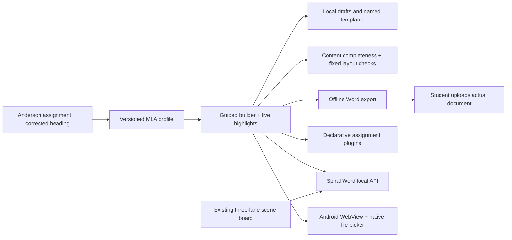

# Spiral Word MLA and Android extension

Scope: existing Spiral Word in this directory. Inventory:
`C:/Users/issda/spiral-word-inventory-20260925.json`. Existing scene-board files
and changes predate this task and are preserved.

Instructor-specific rules: 1-inch margins, Times New Roman 12 pt, double line
spacing, zero paragraph before/after gaps, upper-right surname + automatic
PAGE field on every page, left first-page student/instructor/course/date
heading, centered plain title, automatic 0.5-inch first-line body indentation,
actual page break before Works Cited. The written course correction includes
English 101. The assignment filename overrides the older video example:
`Davis, Issac My MLA Template.docx`. Practice prose remains student-authored.

The phone build must work offline, preserve drafts across rotation, export
actual DOCX files through Android's picker, and keep APIs optional. Preview
guides and highlights are editing aids and must never appear in DOCX output.
Existing governance and provider registry remain available on the server.

Validation: inspect exported ZIP/XML properties, malformed input, Unicode/XML
escaping, templates, browser portrait/landscape, native APK launch/input/rotation
and file export. Record native testing separately from browser viewport tests.
Current host has about 7 GiB free and 1-2 GiB available RAM; preserve the active
Clay writer and use storage host S: for large Android downloads where needed.

Rollback: remove the new MLA route/include and standalone MLA/Android files;
no existing document migration or replacement is required.

Delivered: `mla_web` is the shared offline editor/compiler; `mla_api.py` adds
local governed API routes; `android` packages the same assets with native
save/import and optional HTTP-loopback/HTTPS API access. `MLA_STUDIO.md` records
the instructor rules, limitations, product comparison, usage, and test evidence.
Six new compiler/API tests, nine existing scene-board tests, isolated browser
checks and actual Android 9 emulator flows passed. Drafts survived rotation and
force-stop/relaunch; a native-saved DOCX was pulled back and inspected. No training
code, checkpoint or active-run schedule was changed by this app work.
