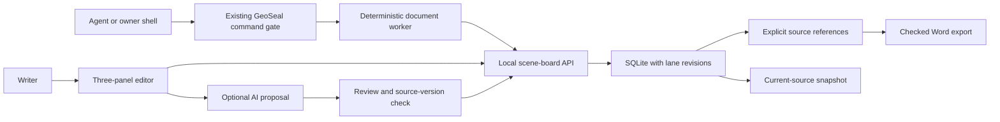

# Long-form writing and shell usability — 2026-09-23

## Verdict

Spiral Word is useful as a local, section-based drafting workspace. Clay/GeoSeal
is useful as its automation companion: inspect a manuscript, preserve a source
snapshot, verify a Word export and stop a workflow when a prerequisite fails.
The pair is ready for a personal writing trial. These tests do not establish
human preference, improved prose quality, whole-book AI continuity or production
collaboration security.

The test manuscript contains **24 sections and 61,056 rendered words**. It uses
original, repeated synthetic prose with distinct chapter sentinels and linked
dialogue. It is a capacity and workflow fixture, not a finished novel. No model,
paid API, cloud compute or user manuscript was used. Clay kept training.

## Tasks and fixes

| Task | Initial result | Current result |
|---|---|---|
| Load and save a long manuscript | Passed | Passed; 72 measured lane saves |
| Export all 24 chapters | Text sentinels survived | Survived; actual OOXML checked |
| Preserve literal `#` and indentation | Failed; prose was reinterpreted as Markdown | Fixed using explicit section export |
| Navigate headings in Word | No heading styles | 24 real Heading1 paragraphs plus styles |
| Return to the last chapter after reload | Reset to first section | Remembers the section |
| Recover an abruptly closed, unsaved tab | Lost unsaved draft | Browser recovery restores it for review |
| Find a chapter by its title or contents | No search | Tested by finding chapter 19 by its sentinel |
| Rename/reorder a chapter | Missing controls | Tested; IDs and lane contents preserved |
| Restore an earlier revision | History API only | Revision dialog; restored text becomes a new revision |
| Resolve a conflicting draft | Draft retained, resolution awkward | Review saved versions or explicitly keep local draft |
| Use mobile with a long manuscript title | Horizontal overflow | Fixed; checked at 390 px |
| Accept an AI proposal based on changed source text | Correctly rejected | Still rejected in rendered tests |
| Separate writers edit different panels | Passed | Still passes; same-panel conflicts remain explicit |

Unsaved recovery is local browser storage, not cloud backup. Save commits to
SQLite. Recovery cannot promise survival after clearing browser data or storage
failure. The UI reports when local recovery storage is unavailable.

## Measured local timings

| Operation | Observation |
|---|---:|
| Open the 61,056-word board | 319 ms |
| Save a lane | Median 20.8 ms; maximum 52.8 ms; 72 writes |
| Export Word with headings | 88 ms |
| Direct Python manuscript audit | Median 242 ms; five calls, range 222–277 ms |
| Same audit through a fresh GeoSeal bridge | Median 980 ms; five calls, range 904–1,057 ms |
| Five audits through one persistent GeoSeal session | 2,840 ms total; 568 ms/call amortized |

Native and fresh-bridge calls alternated order; all returned the same source
hash. The persistent batch is one five-request trial. These are descriptive
observations on this busy Windows PC while training was running, not isolated
benchmarks or a statistically established performance improvement. The plain
and structured exports do different work; their times are not a like-for-like
speed comparison. Repeated test prose compresses especially well.

Use ordinary editor operations for typing. Use the governed shell for complete
document tasks or batches, where its receipts, policy decisions and explicit
failures matter more than per-call latency. Existing persistent NDJSON sessions
avoid restarting the command host for every operation. Exchange large documents
through files and small checked summaries; command frames and tool output have
finite limits.

## Writing use cases

| Use case | Left / center / right | What was checked | Practical limit |
|---|---|---|---|
| Fiction and dialogue | First speaker / scene / second speaker | Attribution, linked edits, source preservation, long chapter navigation | AI pacing, character consistency and style not evaluated |
| Technical guide | Code / explanation / requirements | Indentation, literal characters and references survive assembly/export | Assembly does not execute or validate the code |
| Study guide | Formulas / explanation / practice prompts | Unicode math, notes/bullets and source links survive assembly | Not a math oracle; answers need an independent check |
| Manuscript maintenance | Editor document / governed worker / verified files | Audit, source snapshot, export readback and SHA-256 match | Snapshot contains current lanes, not full historical SQLite state |

The three composition cases are executable tests, not just suggested layouts.
Changing a source panel updates the compiled scene without rewriting the stored
center template or the other source panel. That is a concrete benefit over
manually copying the same passage into several drafts. No human writing-speed
advantage was measured.

## Remaining limits and next priorities

1. **References are positional.** `{{left:1}}` means the current first line.
   Inserting a line above it changes the referenced dialogue. The editor now
   states this. Stable named dialogue cues are the next substantive improvement.
2. **AI context is one section.** The current draft request has no maintained
   whole-book timeline, character bible or citation index. It requests at most
   1,200 output tokens from the provider. A 61k-word storage test does not prove
   that an AI can reason over or rewrite that entire manuscript.
3. **Live writing quality is unmeasured.** Proposal/apply tests use stubs and
   retain human review. No claim about a provider or Clay's prose follows.
4. **Plain text remains the editing medium.** No tracked-changes UI, rich page
   layout, screenplay pagination, footnotes or semantic fact verification.
5. **Local operation only.** No multi-user account roles or public deployment
   was added. API concurrency checks prevent stale overwrites; they are not an
   authentication mechanism.
6. **History browsing shows the latest 50 lane revisions.** Older database
   rows remain stored. Searchable historical archives and full-store backup
   management are future work.

The next writing trial should use one real chapter: outline it, assign two
voices, revise a fact, restore a passage and export it. Record editing friction
and factual continuity before investing in a larger AI writing loop.

## Evidence and reproduction

- Nine `test_scene_board.py` tests pass, including three writing-layout cases.
- Eleven existing Spiral Word checks also pass; the legacy exporter self-test,
  Black, Prettier and scoped whitespace checks pass.
- `check_scene_board.py`: desktop/mobile, real DOCX download, stale proposals,
  literal markup and two-dirty-panel concurrent edit preservation.
- `check_longform.py --label final --tasks --shell`: the 61k manuscript,
  navigation/recovery/revision/reordering tasks and real shell workflow.
- `C:/dev/loom/clay_shell/check_writing.ps1`: paired timings, a persistent
  session, actual file hashes, overwrite rejection, policy block, an independently
  checked `ETIMEDOUT`, and `Confirm-GeoSealResult` stopping a failed prerequisite.
- Final receipt: `../artifacts/writing_usability_20260923/final-1790149925699394100/REPORT.json`.
- Initial receipt: `../artifacts/writing_usability_20260923/baseline-1790149202866785100/REPORT.json`.
- Screenshots and generated documents are alongside each receipt. The final
  shell's files are in its `shell` subfolder.
- A spreadsheet-friendly summary is `../artifacts/writing_usability_20260923/SCORECARD.csv`.

An intermediate test called a blocked inline Python request a timeout because
it checked only `ok=false`. That assertion was wrong. The final test requires
`governance_block` for that request and separately executes a known local worker
with a 100 ms deadline, requiring `process_error=ETIMEDOUT`. No policy was
relaxed. Use the final receipt for the timeout claim.

